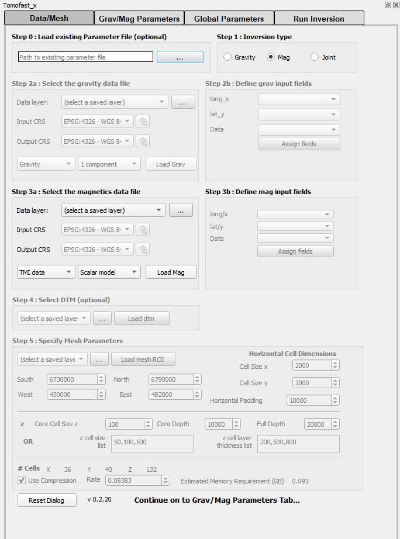
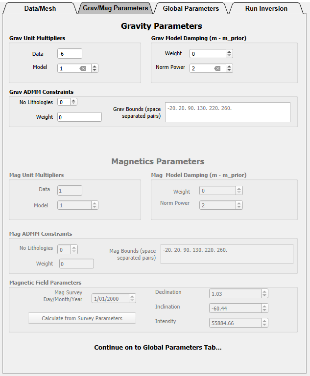
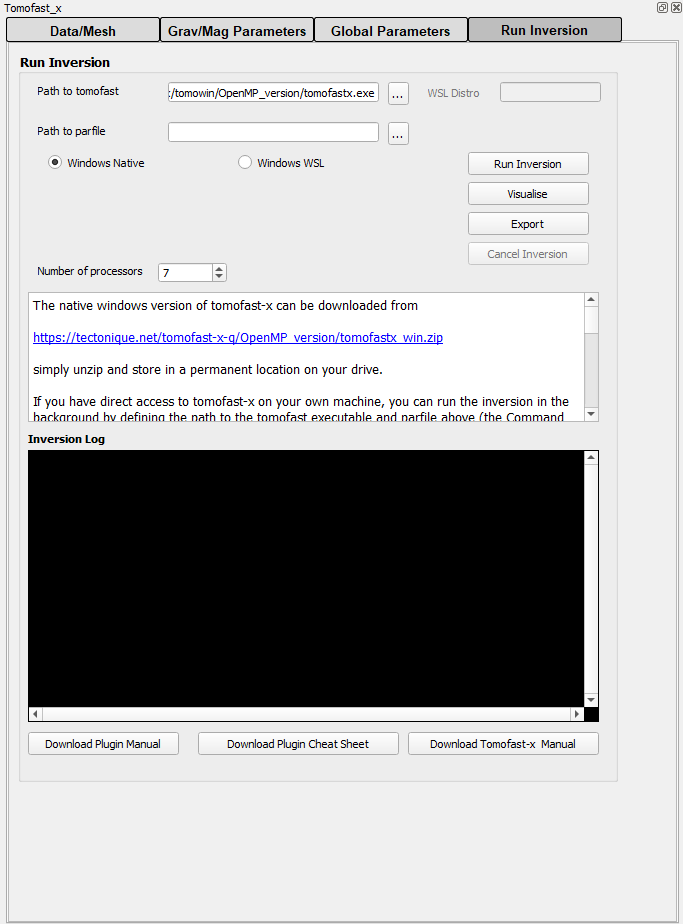

# Tomofast-x QGIS and ArcGIS Pro Plugin v0.2.21
 GIS Plugin to help Tomofast-x usage

 **<a href="https://tectonique.net/tomofast-x-q/Tomofast-x-q%20cheat%20sheet.pdf">Cheat Sheet</a>&nbsp;&nbsp;&nbsp; |&nbsp;&nbsp;&nbsp;<a href="https://tectonique.net/tomofast-x-q/Tomofast-x-q%20User%20Manual.pdf">Download Basic Help Document</a>**&nbsp;&nbsp;&nbsp; |&nbsp;&nbsp;&nbsp;<a href="https://tectonique.net/tomofast-x-q/tomofast_demo.mp4">Ctrl-click on link to watch demo video</a>**

## Recent changes
changelog=0.2.21   
    * Grav/mag data, DTM and mesh ROI can be chosen from layers already open in QGIS (only layers saved to disk are listed: CSV or GeoTIFF/ERS data, GeoTIFF DTM, polygon/line ROI) as well as loaded from disk; the layer's file path is stored for the parameter file, an open raster is reused rather than added again, and a CSV layer's CRS and X/Y columns pre-fill the data fields   
    * Mesh ROI (including a 2D profile line) is re-applied automatically after a new data file is loaded when the CRS is unchanged; a changed CRS warns that the ROI and DTM need reloading   
    * Horizontal padding is set automatically to the model depth when Full Depth or the z cell layer thickness list changes (the sum of the thicknesses if that list is filled in, otherwise the Full Depth); it can still be edited afterwards (QGIS and ArcGIS)   
    * Fix the mpirun file selector on macOS/Linux, which hid files without an extension (QGIS and ArcGIS); mpirun labels and tooltips no longer mention mpiexec or Windows   
    0.2.20   
    * ArcGIS Pro panel brought up to date with the QGIS plugin: native Windows runs launch the MPI-free tomofastx.exe directly (setvars.bat and mpiexec no longer needed), Cancel Inversion button, run log reports the exit code and explains stack overflows, relative paths in parameter files, Visualise implemented, MVI export columns   
    * ArcGIS Pro panel: tooltips for all parameters (with their parfile names) and the Run tab help text with clickable links   
    * Memory estimate and suggested compression rate now refresh reliably (component dropdowns, inversion type, 2D profile, loaded stations, reset) and use the same padded mesh and rule in QGIS and ArcGIS   
    * Suggested compression rate varies continuously with mesh size (no 400,000-cell cutoff), so refining the mesh no longer lowers the estimated memory   
    * First tab fonts made consistent with the second tab; URLs on the Run Inversion tab are clickable   
    0.2.19   
    * Add Magnetisation Vector Inversion (MVI): choose a scalar or vector (3-component) magnetic model, and TMI or Bx,By,Bz data   
    * Add gravity gradiometry: choose gravity or gradiometry data with 1 or 6 (xx,yy,zz,xy,yz,xz) components   
    * Multi-component data: CSV uses the selected data column plus the following columns; GeoTIFF components are found automatically from the Bx/By/Bz or xx/yy/zz/xy/yz/xz tag in the file name   
    * Parameter file writes the new MVI and gradiometry settings (only when non-default); memory estimate accounts for the extra components   
    * Joint inversion: gravity and magnetic nData are now set separately; loading a joint-mode data file only fills that dataset's column selectors   
    * Exported and displayed MVI models use Mx,My,Mz columns and magnitude   
    0.2.18   
    * Native Windows runs: set GFORTRAN_UNBUFFERED_ALL / FORT_BUFFERED so Fortran output is unbuffered and the log updates live   
    * Result preview: x/y/z slices now share one clipped colour range   
    * Setting the number of lithologies above zero sets the ADMM weight to 1000 and major iterations to 50; back to zero sets the weight to 0 and major iterations to 3   
    * Parameter file now uses the ADMM weights and major iterations from the GUI instead of hard-coded overrides   
    * Reset now restores all defaults (ADMM lithologies, norm powers, DTM state, field selectors, kernel path, z-layer lists, survey date)   
    * Fix magnetic model damping weight and norm power being mapped to the gravity widgets   
    0.2.17   
    * Add Cancel Inversion button to kill a running tomofast job (Windows native, WSL, macOS, Linux)   
    * Calculate from Survey Parameters uses the inclination, declination and intensity stored in Noddy GeoTIFF metadata (as imported by SGTool) instead of IGRF   
    0.2.16   
    * Native Windows tomofastx.exe no longer requires OpenMPI: remove setvars.bat and mpiexec widgets and run the exe directly (no batch file)   
    * Number of processors box sets the OpenMP thread count (OMP_NUM_THREADS) for native Windows   
    * Copy parfile to output folder from the plugin on native Windows   
    * Clip data to rectangle ROI, GUI reorganisation   
    0.2.15 First Beta of ArcGIS Pro Toolbox   
    0.2.14   
    * Allow tiff and tif suffix inputs for DTM   
    * Remove Upload_plugin.py script   
    * Fix untested path usage   
    * Add link to new help page and update video to latest GUI  
    * Split run_inversion into os-specific codes    
    * Full load of data layers when loading old parfile  
    * Add built-in display of tomofast output to plugin GUI   
    * Extract profile and create 2D inversion files   
    * Add translations for French, Spanish, Portuguese, Brazilian Portuguese and Mandarin   
    0.2.13   
    * Update calls for newer pandas compatibility   
    * Increase max depths for mesh generation   
    * Update requirements   
    * Fix IGRF calc   
    * Fix joint inversion workflow   
    * Add multiple z cell thicknesses   
    0.2.12   
    * Allow simpler Windows runtime install   
    0.2.11   
    * Add support for Native Windows tomofast-x    
    * remove data field from mesh file   
    * minor GUI reorganisation   
    0.2.10   
    * Remove pre command widget for WSL (no longer needed)    
    * Allow Linux definition of mpirun path   
    * Allow outputs to be stored on linux drive   
    * Compatibility with both QGIS4/QT6 and QGIS3/QT5  
    0.2.9   
    * Add export to csv option
 
    
## QGIS Plugin Install
Use QGIS Plugin Manager in QGIS 3.xx to install the latest released version from the Plugin Repository (experimental). To get the newest version, download the zip file of the **main** branch of this repository and use Install from Zip file in the QGIS Plugin Manager of QGIS 3.xx or QGIS 4.xx.   

## ArcGIS Pro: THIS IS VERY BETA!!!
1) Download the zip file of the **main** branch of this repository, unzip it and store it somewhere safe.
2) In order to run python code in ARCGIS Pro you will need to manually add some python libraries so Tomofast-x has everything it needs:
- a) Open Package Manager: Click the Project tab on the ribbon and select Package Manager from the side menu. Access Environment Manager (Gear icon to right of active environemnt): 
  - i) Click the Environment Manager button (top right) to open the management dialog.
  - ii) Clone the Environment: Locate the environment you wish to copy (usually arcgispro-py3) and click the Clone button next to it.
  - iii) Set Destination: In the Clone Environment dialog, provide a name and path for your new environment or leave it as the default.
  - iv) Finalize: Click OK. The cloning process may take several minutes.
- b) Once the cloned environment has been created, search for and install the following packages, **if they are not already installed**:
  - pandas
  - pyvista (needed for Visualise)
- c) In the ArcGIS Pro Catalogue area, go to Add toolbox and select the file **Tomofast_X.pyt** in the **ARCGIS** directory in this repository. 
- d) Double click on the new **Tomofast_X.pyt** Toolbox to get the list of functions that can be run, and select  **Open Tomofast-x Panel** then **run** to launch the Tomofast_x_q GUI.     

## Tomofast-x Install
To use this plugin to its full potential you may want to install Tomofast-x itself on the same computer on which you are running QGIS.

See the [Installation instructions](https://github.com/TOMOFAST/Tomofast-manual/blob/main/install.md) for detailed installation instructions.

## Simple instructions

**Tooltips in plugin provide parameter name used in paramfile in squre brackets to help with subsequent manual editing**   
   
**Select tomofast-x-q plugin and Select Data/Mesh tab**   
    
A. Optionally pre-load an existing paramfile from disk [Step 0]      
B. Select Grav, mag or both Inversion stype [Step 1]   
C. Select a data layer already open in QGIS (must be saved to disk: csv points or tif/ers raster) from the drop-down, or load a csv, tif or ers file from disk with the ... button; define input and output projections, and Load data [Step 2a or Step 3a; Load Grav / Load Mag]   
D. If csv data, select fields for lat_x, long_y & data [Step 2b or Step 3b, data loaded to QGIS once Assign fields button selected]   
E. Select an open, saved DTM tif layer from the drop-down and press Load dtm (or load a tif from disk with the ... button), or use constant value [Step 4 reprojected dtm loaded to QGIS]   
F. Specify mesh parameters [Step 5] (optionally defined from max/min x,y extents of a polygon layer, or a 2D section defined by a straight line polyline layer, chosen from the open saved layers with Load mesh ROI or loaded from disk with the ... button; the ROI is re-applied if you load a new data file with the same CRS, otherwise reload it and the DTM). The horizontal padding is set automatically to the model depth (the sum of the z cell layer thicknesses if that list is filled in, otherwise the Full Depth) whenever those change, and can be edited afterwards. Check Model Grid Size to make sure the mesh is not stupidly large. z cell parameters can either be defined as a two layer system (with finer cells in the upper layer then progressively coarser cells beneath that) or as a multi z cell system (with comma separated lists of cell size and layer thicknesses, with the latter being multiples of the equivalent cell size)   
G. Define compression amount. Check the Estimated Memory Requirements to make sure you run the inversion on a computer with enough memory.    
    
**Select Grav/Mag Parameters tab**   
    
H. For mag survey autofill (Calculate from Survey Parameters, using IGRF at the centroid of the mesh, or the inclination, declination and intensity stored in the metadata of a Noddy GeoTIFF) or define Magnetic Field parameters   
   
**Select Global Parameters tab**   
     
I. Specify Global Inversion parameters   
J. Modify parameters and then save out  File by clicking on Save Files button [Data and Parameter file written out]  
K. Define output directory and mesh and data files will then be written out and loaded to QGIS     
The **Reset Dialog** button on the Data/Mesh tab restores all defaults.   
 
   
**Run tomofast-x from plugin using the just-generated files**   
    
L. If you have tomofast-x installed on your machine, you can run it directly from this tab, after defining the path to the tomofastx executable and the paramfile, and the number of processors to use. Press **Run Inversion** to start; the tomofast-x output is shown live in the log window, with PASS/FAIL checks after the run, and **Cancel Inversion** stops a running job. When it finishes, **Visualise** shows the resulting model (requires pyvista) and **Export** writes it to csv. The tab also has buttons to download the plugin manual, the Tomofast-x manual and the plugin cheat sheet.    
   
Under Windows this can be run as a native tomofastx.exe file or via WSL2 (Windows Subsystem For Linux v2), so you will need to specify which type of Windows you will run and:
- For **Native Windows** use you only need the path to the MPI-free tomofastx.exe; no OpenMPI, setvars.bat or mpiexec is required; the "number of processors" box sets the number of OpenMP threads
- For **WSL** specify which Linux Distribution is installed in the **WSL Distro** text area (mpirun must be available in the WSL distro)
- For **MacOs** use you will have to specify the path to the OpenMPI mpirun binary
   
Otherwise copy these files to another machine and run tomofast-x there (but you will have to fix the paths in the **paramfile.txt** file first)    
- **data_magn.csv and/or data_grav.csv**: observed geophysical response   
- **model_grid.txt**: Model mesh   
- **elevation_grid.csv**: elevations (topography) on the mesh grid   
- **paramfile.txt**: parameter definition file (on native Windows the plugin also copies it into the output folder)   

## Magnetisation vector inversion (MVI) and gravity gradiometry
Each data group on the Data/Mesh tab has two dropdowns. Their tooltips show the parameter name written to the paramfile.   

| Dropdown | Choices | Paramfile parameter |
|---|---|---|
| Gravity: type | Gravity / Gradiometry | forward.data.grav.type = 1 / 2 |
| Gravity: components | 1 (Gz/Gzz) / 6 (full tensor: xx, yy, zz, xy, yz, xz). Fixed at 1 for plain gravity | forward.data.grav.nDataComponents |
| Magnetic: data | TMI (1) / Bx,By,Bz (3) | forward.data.magn.nDataComponents |
| Magnetic: model | Scalar / Vector (MVI, solves for Mx, My, Mz per cell) | modelGrid.magn.nModelComponents = 1 / 3 |

Non-default values only are written to the paramfile, so scalar gravity and magnetic runs produce the same file as before. Gradiometry also sets the depth weighting power to 3 and changes the default target misfit (data are in Eotvos). Magnetic inversion defaults the target misfit to 5. The memory estimate grows with (data components x model components).   

**csv files**: the column selected as **Data** is the first component, and the following columns of the file are the other components, in file order. All components are written to data_grav.csv / data_magn.csv after the three position columns.   
- Gravity, 1 component: that column only. 6 components: the selected column is xx, then yy, zz, xy, yz, xz must follow it.   
- Magnetic, TMI: that column only. Bx,By,Bz: the selected column is Bx, then By and Bz must follow it.   

**GeoTIFF files**: select any one of the component files and the others are found in the same folder. The file names must be identical except for a tag naming the component, in any upper or lower case and set off from the rest of the name by a non-alphanumeric character such as _ - or .   
- Gravity gradiometry (6): xx, yy, zz, xy, yz, xz, e.g. gg_xx.tif, gg_yy.tif, gg_zz.tif, gg_xy.tif, gg_yz.tif, gg_xz.tif   
- Magnetic Bx,By,Bz (3): Bx, By, Bz, e.g. mag_Bx.tif, mag_By.tif, mag_Bz.tif   
- All component files must be on the same grid and projection. A missing file or a mismatched grid gives an error message when the data are loaded.   

**MVI results**: Visualise colours the model by the magnitude of the magnetisation vector, and Export writes the columns x, y, z, Mx, My, Mz.   

**Troubleshooting**: if the run log ends with exit code 3221225725 (0xC00000FD) the Windows tomofastx.exe has run out of stack space, which large problems such as MVI can cause. Raise its stack size with `python scripts/set_exe_stack.py path/to/tomofastx.exe`, or link the executable with `-Wl,--stack,536870912`.   

## Credits    
Plugin construction - Mark Jessell using QGIS Plugin Builder Plugin and code from Vitaliy Ogarko   
Tomofast-x - Vitaliy Ogarko   
IGRF calculation - https://github.com/klaundal/ppigrf  
