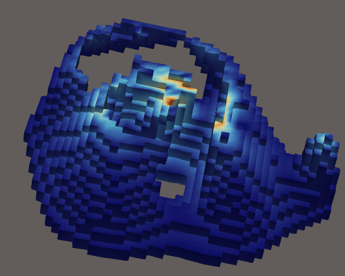

# Tomofast-x QGIS and ArcGIS Pro Plugin v0.2.25
 GIS Plugin to help Tomofast-x usage

**[User Manual](docs/UserManual.md)** &nbsp;|&nbsp; **[Reference Manual](docs/ReferenceManual.md)** &nbsp;|&nbsp; **[Changelog](CHANGELOG.md)** &nbsp;|&nbsp;  
   
  
Magnetic inversion of the igneous intrusions hosting  the Cajati Carbonatite complex, SE Brazil    
   
## Documentation
* [User Manual](docs/UserManual.md): a step-by-step magnetic inversion with the Cajati example data, covering only the required fields
* [Reference Manual](docs/ReferenceManual.md): every tab, field and button, including optional parameters, joint grav + mag inversions, MVI, gravity gradiometry and troubleshooting
* [Changelog](CHANGELOG.md): full version history

Tooltips in the plugin show the paramfile name of each parameter in square brackets.

## Frost: fast FFT inversion
Tick **Frost** in Step 1 to invert a gridded (GeoTIFF/ERS) gravity or magnetic data set with a fast Fourier-transform method instead of Tomofast-x. It returns the smallest depth-weighted model that fits the data to the noise level (by default 2 % of the largest datum), with no bounds or other constraints, in seconds even for large grids. It runs inside QGIS or the ArcGIS Pro panel, so Tomofast-x is not needed for it.
- With Frost ticked, the mesh cell size is set to the grid cell size (x, y and z), padding is 0 and the DTM step is disabled. Joint inversion, CSV point data, gravity gradiometry, multi-component data, MVI and 2D profiles are not supported.
- **Save Files** writes the data as usual and adds `global.useFFT = 1` to `paramfile.txt`. **Run Inversion** runs Frost for any parameter file with `global.useFFT = 1`, and Tomofast-x otherwise.
- The depth-weighting power, sensor height, unit multipliers and IGRF field are taken from the plugin settings. A sensor height of 0 is treated as 1 m (ground data).
- Results: `OUTPUT/Paraview` holds the same VTK files that Tomofast-x writes (so **Visualise** and ParaView work as usual); `OUTPUT/Frost` holds the model (`*_final_model_full.txt`, also used by **Export Model**), the observed, calculated and residual data, `frost_summary.txt` and `frost_log.txt`.
- Needs the Python package `scipy` (included by the ArcGIS Pro setup tool; in QGIS install it if it is missing). The inversion code is `fast_inversion.py`; `frost_runner.py` drives it from a parameter file and can also be run on its own: `python frost_runner.py paramfile.txt`.

## QGIS Plugin Install
Use QGIS Plugin Manager in QGIS 3.xx to install the latest released version from the Plugin Repository (experimental). To get the newest version, download the zip file of the **main** branch of this repository and use Install from Zip file in the QGIS Plugin Manager of QGIS 3.xx or QGIS 4.xx.   

## ArcGIS Pro Install
1) Download the zip file of the **main** branch of this repository, unzip it and store it somewhere safe.
2) In the ArcGIS Pro Catalog pane, go to **Toolboxes > Add Toolbox** and select the file **Tomofast_X.pyt** in the **ARCGIS** directory in this repository.
3) Tomofast-x needs some Python libraries that ArcGIS Pro does not include. The default environment (arcgispro-py3) cannot be changed, so they go into a clone of it. Either use the setup tool (3A, recommended) or do it by hand (3B).

### 3A) Setup tool (Recommended)
> **Note:** the tool creates a **new** environment, `arcgispro-py3-geotools`, as a copy of `arcgispro-py3`. It does not change `arcgispro-py3` or any other environment you already have. It then makes the new environment the one ArcGIS Pro uses, so **restart ArcGIS Pro** when it has finished. To go back, choose another environment in **Project > Package Manager** and restart ArcGIS Pro. The tool cannot change or delete the environment ArcGIS Pro is using at the time, so to run it again with *Delete the environment first*, switch to another environment and restart first.

- In the Tomofast_X toolbox, open **Setup > Set Up Python Environment** and click **Run**.
- The tool clones arcgispro-py3 into a new environment called **arcgispro-py3-geotools**, installs the missing packages, checks that they all import, and makes the new environment the one ArcGIS Pro uses. It needs an internet connection and takes about 10 minutes. Click **View Details** in the Geoprocessing pane to follow its progress.
- When it has finished, **restart ArcGIS Pro**.
- The same tool is in the **SGTool**, **tomofast_x_q** and **GeoSubSampler** toolboxes and installs what all three need, so you only need to run it once. Running it again only adds what is missing.
- Its options let you choose a different environment name, leave ArcGIS Pro's active environment unchanged (activate it later in Package Manager), or delete the environment and start again from a new clone.
- The tool runs the script `ARCGIS/setup_arcgispro_env.py`, which can also be run from a Windows Command Prompt (change the paths if ArcGIS Pro is somewhere else and in any case to the script in this repository):
  ```
  "C:\Program Files\ArcGIS\Pro\bin\Python\envs\arcgispro-py3\python.exe" "C:\path\to\tomofast_x_q\ARCGIS\setup_arcgispro_env.py"
  ```

### 3B) By hand
- a) Open Package Manager: Click the Project tab on the ribbon and select Package Manager from the side menu. Access Environment Manager (Gear icon to right of active environemnt): 
  - i) Click the Environment Manager button (top right) to open the management dialog.
  - ii) Clone the Environment: Locate the environment you wish to copy (usually arcgispro-py3) and click the Clone button next to it.
  - iii) Set Destination: In the Clone Environment dialog, provide a name and path for your new environment or leave it as the default.
  - iv) Finalize: Click OK. The cloning process may take several minutes.
- b) Once the cloned environment has been created, search for and install the following packages, **if they are not already installed**:
  - pandas
  - scipy (needed for Frost)
  - pyvista (needed for Visualise). It is not in Package Manager, so install it from a Windows Command Prompt with the clone's Python, e.g. `"%LOCALAPPDATA%\ESRI\conda\envs\<your-clone>\python.exe" -m pip install pyvista`
- c) Activate the clone and restart ArcGIS Pro.

4) Double click on the new **Tomofast_X.pyt** Toolbox to get the list of functions that can be run, and select  **Open Tomofast-x Panel** then **run** to launch the Tomofast_x_q GUI.     

## Tomofast-x Install
To use this plugin to its full potential you may want to install Tomofast-x itself on the same computer on which you are running QGIS.

See the [Installation instructions](https://github.com/TOMOFAST/Tomofast-manual/blob/main/install.md) for detailed installation instructions.

## Credits    
Plugin construction - Mark Jessell using QGIS Plugin Builder Plugin and code from Vitaliy Ogarko   
Tomofast-x - Vitaliy Ogarko   
Frost fast FFT inversion (fast_inversion.py) - Vitaliy Ogarko   
IGRF calculation - https://github.com/klaundal/ppigrf  
