# Tomofast-x-q Reference Manual

A description of every control, file and parameter in the Tomofast-x QGIS plugin, version 0.2.23. For a shorter walk-through of the required steps only, see the [user manual](UserManual.md).

[User Manual](UserManual.md) · [Changelog](../CHANGELOG.md) · [Cheat sheet (PDF)](https://tectonique.net/tomofast-x-q/Tomofast-x-q%20cheat%20sheet.pdf) · [Tomofast-x](https://github.com/TOMOFAST/Tomofast-x) · [README](../README.md)

**Contents**

1. [Conventions](#1-conventions)
2. [Installation and requirements](#2-installation-and-requirements)
3. [Workflow summary](#3-workflow-summary)
4. [Data/Mesh tab](#4-datamesh-tab)
5. [How the mesh is built](#5-how-the-mesh-is-built)
6. [How the data are prepared](#6-how-the-data-are-prepared)
7. [Grav/Mag Parameters tab](#7-gravmag-parameters-tab)
8. [Global Parameters tab](#8-global-parameters-tab)
9. [Run Inversion tab](#9-run-inversion-tab)
10. [Post-run checks](#10-post-run-checks)
11. [Files written and read](#11-files-written-and-read)
12. [Parameter file reference](#12-parameter-file-reference)
13. [Magnetisation vector inversion (MVI) and gravity gradiometry](#13-magnetisation-vector-inversion-mvi-and-gravity-gradiometry)
14. [Joint inversion](#14-joint-inversion)
15. [ADMM bound constraints](#15-admm-bound-constraints)
16. [2D profile inversion](#16-2d-profile-inversion)
17. [Troubleshooting](#17-troubleshooting)
18. [ArcGIS Pro toolbox](#18-arcgis-pro-toolbox)

---

## 1. Conventions

**Applies to** (the same colours as the cheat sheet):

| Tag | Meaning |
|---|---|
| 🟧 **Grav** | needed for gravity inversions |
| 🟦 **Mag** | needed for magnetic inversions |
| 🟩 **Both** | needed for every inversion |
| ⬜ **Optional** | has a default or can be skipped |

- A joint inversion needs everything marked 🟧 Grav, 🟦 Mag and 🟩 Both.
- Where a tag is followed by *(CSV)*, the control is needed only for point data in CSV files.
- **Parfile key** is the name of the entry in `paramfile.txt`. The plugin's tooltips show it in square brackets. Keys written with a leading `#` are comments for Tomofast-x: the plugin writes them so that it can read the file back in (Step 0), and Tomofast-x ignores them.
- Lengths are in metres. Coordinates are in the output CRS.
- Example values come from the magnetic inversion of the Cajati example used in the user manual: 500 m cells, 5,000 m core and 10,000 m full depth.

---

## 2. Installation and requirements

### Plugin

- QGIS 3.24 to 4.x (Qt5 or Qt6). Install from the QGIS plugin repository (**Plugins > Manage and Install Plugins**), or install the zip file of the **main** branch with **Install from ZIP**.
- Python packages: `pandas` and `pyproj` (both normally included with QGIS). `pyvista` is needed only for **Visualise**.
- The plugin adds a **TF-x** toolbar button and menu entry that open a dock panel on the right of the main window, tabbed with any other docks there.
- macOS: the panel uses a smaller font and the Fusion style so that it fits on the screen. Set the QGIS setting `Tomofast_x/compactMacUI` to `false` to keep the native look.
- The interface is translated into French, Spanish, Portuguese (European and Brazilian) and Mandarin, following the QGIS locale.

### Tomofast-x

| Platform | How Tomofast-x is run | What you need |
|---|---|---|
| Windows, native | The MPI-free OpenMP build `tomofastx.exe` is started directly. The number of processors sets `OMP_NUM_THREADS`. | [tomofastx_win.zip](https://tectonique.net/tomofast-x-q/OpenMP_version/tomofastx_win.zip), unzipped somewhere permanent. No setvars.bat, mpiexec or Intel MPI is needed (these were used before 0.2.16). |
| Windows, WSL | `mpirun` is run inside a WSL Linux distribution. | Tomofast-x and OpenMPI built in the WSL distribution, and the distribution name. |
| macOS | `mpirun -np N tomofastx -p paramfile` | Tomofast-x and OpenMPI (for example from Homebrew). The path to `mpirun` if it is not on the PATH. |
| Linux | As for macOS. | As for macOS. |

Build instructions: [Tomofast-x installation guide](https://github.com/TOMOFAST/Tomofast-manual/blob/main/install.md). You can also write the input files on one computer and run Tomofast-x on another. The paths in `paramfile.txt` are relative to its folder, so copy the whole folder.

---

## 3. Workflow summary

1. **Data/Mesh**: Step 0 (optional) reload a parameter file. Step 1 choose the inversion type. Steps 2 and 3 load the gravity and/or magnetic data. Step 4 (optional) load a DTM. Step 5 define the mesh.
2. **Grav/Mag Parameters**: sensor heights, the Earth's field (magnetics), and optional unit multipliers, damping and ADMM constraints.
3. **Global Parameters**: description, iterations, target misfit, joint weights and sensitivity kernel. **Save Files** writes the data, mesh and `paramfile.txt`.
4. **Run Inversion**: run Tomofast-x, read the log and checks, then **Visualise** and **Export** the result.

You can change parameters after **Save Files** and press it again. The files are rewritten.

---

## 4. Data/Mesh tab

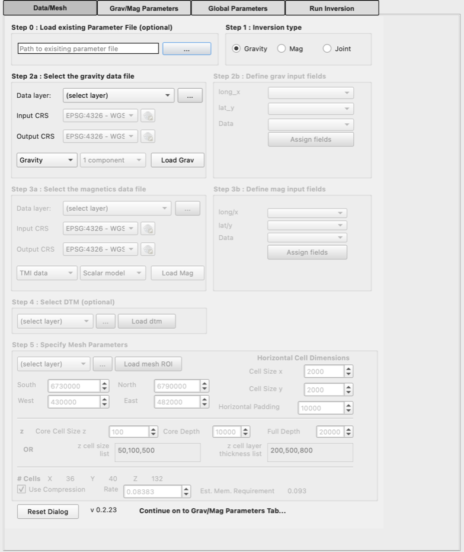

*Starting state (Gravity selected, default mesh).*

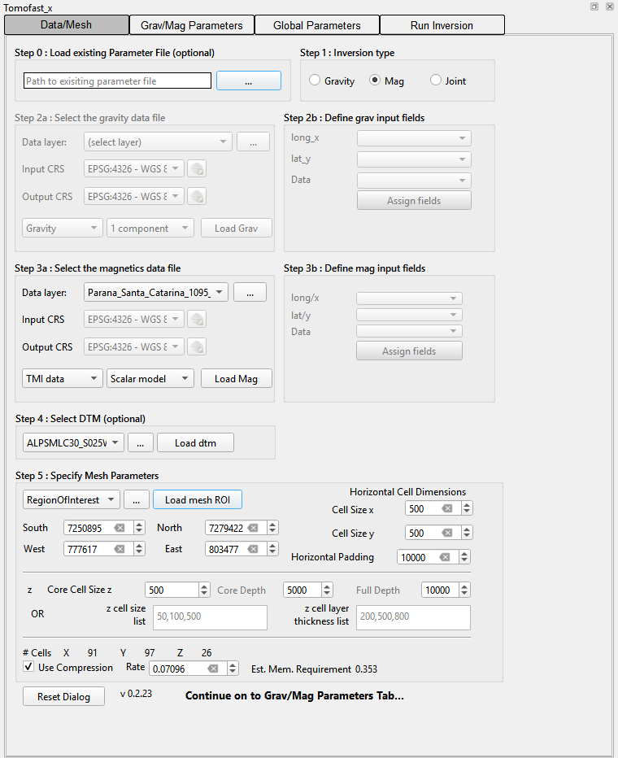

*Cajati example: Mag, DTM, ROI and a 500 m mesh.*

### Step 0: Load existing Parameter File ⬜ Optional

**...** chooses a `paramfile.txt`. Every key in the file that the plugin recognises is copied to its control (see [section 12](#12-parameter-file-reference)). Then the data files, DTM and ROI named in the file's `#anomalies…data.file`, `#global.elevFilename` and `#roi.filename` entries are loaded again as QGIS layers, if they still exist. Use it to repeat or change an earlier experiment. Files not written by the plugin can be loaded too, but only their Tomofast-x keys are used.

### Step 1: Inversion type 🟩 Both

| Choice | Parfile | Effect |
|---|---|---|
| Gravity | `#global.experimentType = 1` | Enables the gravity controls. Target misfit default `1e-7` (`3` for gradiometry). |
| Mag | `#global.experimentType = 2` | Enables the magnetic controls, including the magnetic field. Target misfit default `5` (but see the [target misfit note](#17-troubleshooting)). |
| Joint | `#global.experimentType = 3` | Enables both. The mesh, DTM and ROI use the gravity CRS. See [Joint inversion](#14-joint-inversion). |

### Steps 2a and 3a: Select the gravity / magnetics data file

Step 2a 🟧 Grav and Step 3a 🟦 Mag work the same way.

| Control | Applies | Parfile key | Description |
|---|---|---|---|
| Data layer (drop-down) | 🟧 Grav 🟦 Mag | `#anomalies.grav.data.file`, `#anomalies.magn.data.file` | Lists the project layers that are saved to disk and have a suitable format: GeoTIFF (`.tif`/`.tiff`) or ERS rasters, and CSV delimited-text layers. Memory layers and processing outputs are not listed because the parameter file needs a real path. The list refreshes each time it is opened. For a CSV layer the Input CRS is set from the layer. |
| **...** | ⬜ Optional |  | Chooses a `.csv`, `.tif`/`.tiff` or `.ers` file from disk instead of a layer. |
| Input CRS | 🟧 Grav 🟦 Mag (CSV) | `#anomalies.grav.proj.in`, `#anomalies.magn.proj.in` | CRS of the x/y columns in the CSV file (default EPSG:4326). Enabled only for CSV files. For rasters the raster's own CRS is used. |
| Output CRS | 🟧 Grav 🟦 Mag (CSV) | `#anomalies.grav.proj.out`, `#anomalies.magn.proj.out` | Projected CRS in metres that the points are converted to, and in which the mesh is built. For rasters this is the raster's CRS. |
| Gravity / Gradiometry | ⬜ Optional | `forward.data.grav.type` (1 or 2) | Type of gravity data. See [section 13](#13-magnetisation-vector-inversion-mvi-and-gravity-gradiometry). |
| 1 component / 6 components | ⬜ Optional | `forward.data.grav.nDataComponents` | Gradiometry only: Gzz alone, or the full tensor (xx, yy, zz, xy, yz, xz). Fixed at 1 for gravity. |
| TMI data / Bx,By,Bz data | ⬜ Optional | `forward.data.magn.nDataComponents` (1 or 3) | Total magnetic intensity, or three-component field data. |
| Scalar model / Vector (MVI) | ⬜ Optional | `modelGrid.magn.nModelComponents` (1 or 3) | Solve for susceptibility, or for a magnetisation vector (Mx, My, Mz) in each cell. |
| **Load Grav** / **Load Mag** | 🟧 Grav 🟦 Mag |  | Reads the chosen data. A raster is added to the map (or the open layer is reused) and its extent is copied to the mesh limits in Step 5. For multi-component rasters the matching component files are found and checked. For a CSV file the column lists in Step 2b/3b are filled. If a mesh ROI was loaded earlier with the same CRS it is re-applied; if the CRS has changed you are asked to reload the ROI and the DTM. |

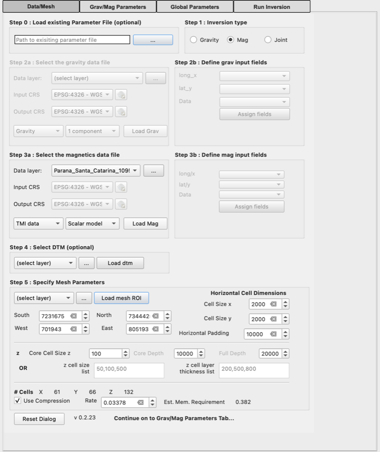

*After **Load Mag** with the Cajati grid: the Step 5 limits hold the raster extent.*

### Steps 2b and 3b: Define input fields 🟧 Grav 🟦 Mag (CSV)

| Control | Description |
|---|---|
| long_x / long/x | Column holding longitude or easting. Pre-selected from the layer if it was opened as delimited text with X/Y fields. |
| lat_y / lat/y | Column holding latitude or northing (defaults to the second column). |
| Data | Column holding the data (defaults to the third column). For multi-component data this is the *first* component, and the following columns of the file must hold the remaining components in order: yy, zz, xy, yz, xz after xx, or By and Bz after Bx. |
| **Assign fields** | Reads the points with these columns and adds them to the map as a coloured point layer. The number of points is used in the memory estimate. |

### Step 4: Select DTM ⬜ Optional

| Control | Parfile key | Description |
|---|---|---|
| DTM layer (drop-down) | `#global.elevFilename` | GeoTIFF raster layers saved to disk. |
| **...** |  | Chooses a GeoTIFF from disk and loads it immediately. |
| **Load dtm** | `#global.elevType = 2`, `forward.depthWeighting.type = 2` | Reprojects the DTM from the data input CRS to the output CRS (nearest neighbour). The result is added as *Reprojected DTM*. |

With a DTM, the data heights are the ground elevation under each point plus the sensor height, the mesh top follows the topography (`elevation_grid.csv`), and depth weighting is applied relative to the topography. Without one, the ground is flat at 0 m and `#global.elevType = 1`. If the DTM is smaller than the mesh, cells outside it get no elevation value, so use a DTM that covers the whole padded mesh.

### Step 5: Specify mesh parameters

| Control | Applies | Parfile key | Default | Description |
|---|---|---|---|---|
| ROI layer (drop-down) and **Load mesh ROI** | ⬜ Optional | `#roi.filename` |  | A polygon or line layer saved to disk (OGR formats such as shapefile or GeoPackage). It is reprojected to the output CRS. A polygon sets South/North/West/East to its bounding rectangle. A line with exactly two vertices switches to [2D profile mode](#16-2d-profile-inversion). |
| **...** | ⬜ Optional |  |  | Chooses a shapefile from disk and loads it immediately. |
| South, North, West, East | 🟩 Both | `#mesh.south` … `#mesh.east` | Raster extent, or 6730000 / 6790000 / 430000 / 482000 | Limits of the model core in the output CRS, without padding. Raster data are sampled only inside these limits. |
| Cell Size x, Cell Size y | 🟩 Both | `#mesh.cellx`, `#mesh.celly` | 2000 | Horizontal size of the core cells. For raster data this is also the data spacing. |
| Horizontal Padding | 🟩 Both | `#mesh.padding` | Model depth | Distance added on every side of the core. It is set automatically to the sum of the z layer thicknesses, or to Full Depth if the lists are empty, whenever those change. Editing it afterwards is allowed. |
| Core Cell Size z | 🟩 Both (method 1) | `#mesh.cellz` | 100 | Vertical cell size in the core. |
| Core Depth | 🟩 Both (method 1) | `#mesh.z.coreDepth` | 10000 | Depth reached by cells of the core size. |
| Full Depth | 🟩 Both (method 1) | `#mesh.z.fullDepth` | 20000 | Total depth. The interval between core and full depth is filled with cells that grow by 15% each. |
| z cell size list | 🟩 Both (method 2) | (not stored) | empty | Comma-separated cell sizes, one per depth layer, top first, e.g. `50,100,500`. |
| z cell layer thickness list | 🟩 Both (method 2) | (not stored) | empty | Comma-separated layer thicknesses, e.g. `200,500,800`. Each should be a multiple of its cell size. When both lists are filled in they replace method 1. |
| # Cells X, Y, Z | display | `modelGrid.size` (final) |  | Estimated number of cells including padding (see the note below). |
| Use Compression | ⬜ Optional | `forward.matrixCompression.type` | on (1) | Wavelet compression of the sensitivity matrix. It reduces memory and run time. |
| Rate | ⬜ Optional | `forward.matrixCompression.rate` | automatic | Fraction of the matrix kept (smaller means more compression). It is set automatically from the mesh size to aim for about 1% compression error. You can override it. |
| Est. Mem. Requirement | display |  |  | Estimated memory for the sensitivity matrix, in GB. |
| **Reset Dialog** |  |  |  | Restores every control on every tab to its default. |

---

## 5. How the mesh is built

### Horizontal

The core runs from West to East and South to North in cells of *Cell Size x* by *Cell Size y*. Padding cells are then added on each side. Each padding cell is 1.15 times the size of the one before, and cells are added until the padding distance is reached. The padding therefore needs far fewer cells than the core would.

### Vertical

- **Method 1 (core / full depth):** *Core Depth* ÷ *Core Cell Size z* cells of the core size, then cells growing by 15% until *Full Depth* is reached.
- **Method 2 (lists):** for each pair, round(thickness ÷ cell size) cells are used, adjusted so that each layer has exactly the stated thickness.

### Cell counts and memory

The **# Cells** display assumes, for speed, that padding cells are the same size as core cells (horizontal) and uses a log-based count for the vertical padding. It therefore **over-estimates** the mesh size. For the Cajati example it shows 91 × 97 × 26, whereas the mesh written (`modelGrid.size`) is 71 × 77 × 16 = 87,472 cells. The memory estimate and the automatic compression rate use the same over-estimate, so they err on the safe side.

```
memory (GB) = 8 × rate × nx × ny × nz × rows / 1024³
rows        = Σ over datasets of  stations × data components × model components
rate        = min(1, 2 × 35.07 × 0.01^-0.872 × (nx·ny·nz)^-0.884)     (× 100 in 2D mode)
```

Without compression, rate = 1. Stations are the number of CSV points once loaded, otherwise the number of core cells (one data point per core cell for rasters).

---

## 6. How the data are prepared

| Input | What happens on Save Files |
|---|---|
| Raster (GeoTIFF, ERS) | The mesh is written first. The raster is reprojected and sampled at the centre of every *core* cell inside South/North/West/East, so there is one data point per core cell (2,949 for the Cajati example). Nodata cells are dropped. |
| CSV points | All rows are converted from the input to the output CRS and used. Points are **not** clipped to the mesh, so clip the file to your area before loading it if needed. |
| Heights | Tomofast-x uses z positive downwards. Each data point gets z = −(ground elevation + sensor height), where the ground elevation comes from the DTM, or is 0 without one. |
| Units | Values are written unchanged. Tomofast-x multiplies them by the data unit multiplier ([section 7](#7-gravmag-parameters-tab)). |

> [!WARNING]
> **Use anomaly data.** The plugin does not remove a regional field or the IGRF. Magnetic total-field grids (such as the Cajati `MAGMIC` grid, mean ≈ 22,850 nT) must be reduced to anomalies first, otherwise the inversion needs unrealistic susceptibilities and the [susceptibility check](#10-post-run-checks) warns. Gravity should be a Bouguer (or residual) anomaly.

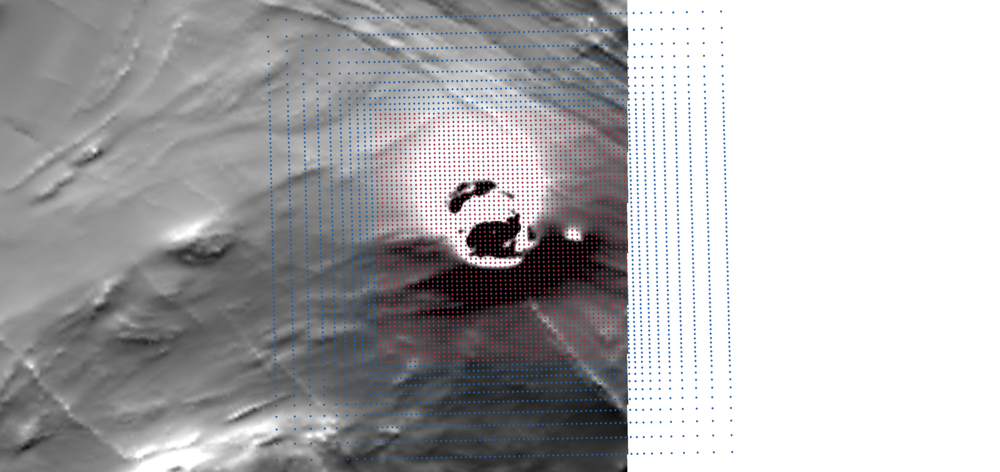

*Cajati example after Save Files: mesh cell centres (blue) and the data points sampled at core cell centres (red).*

---

## 7. Grav/Mag Parameters tab

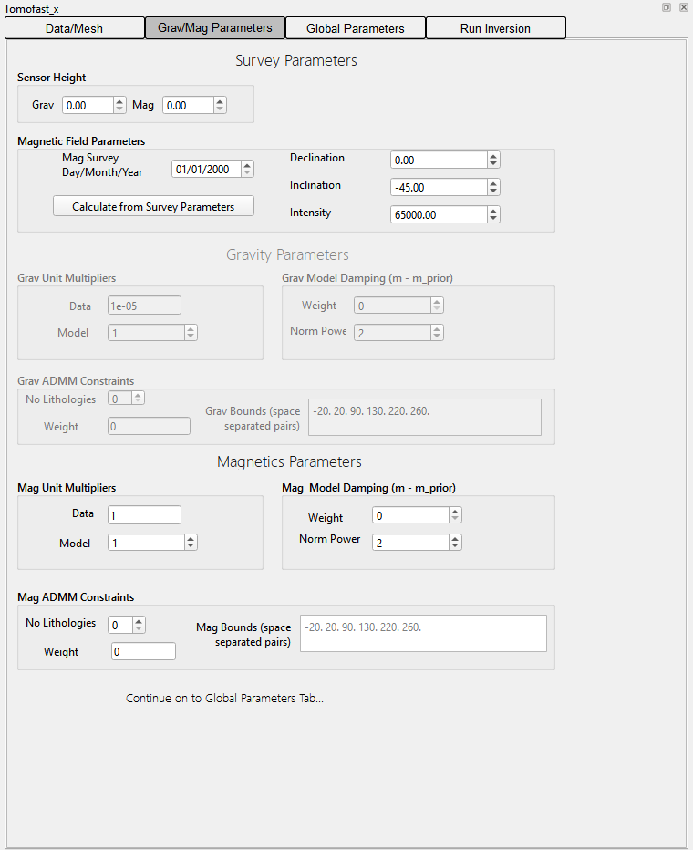

*Defaults (Mag inversion, so the gravity boxes are disabled).*

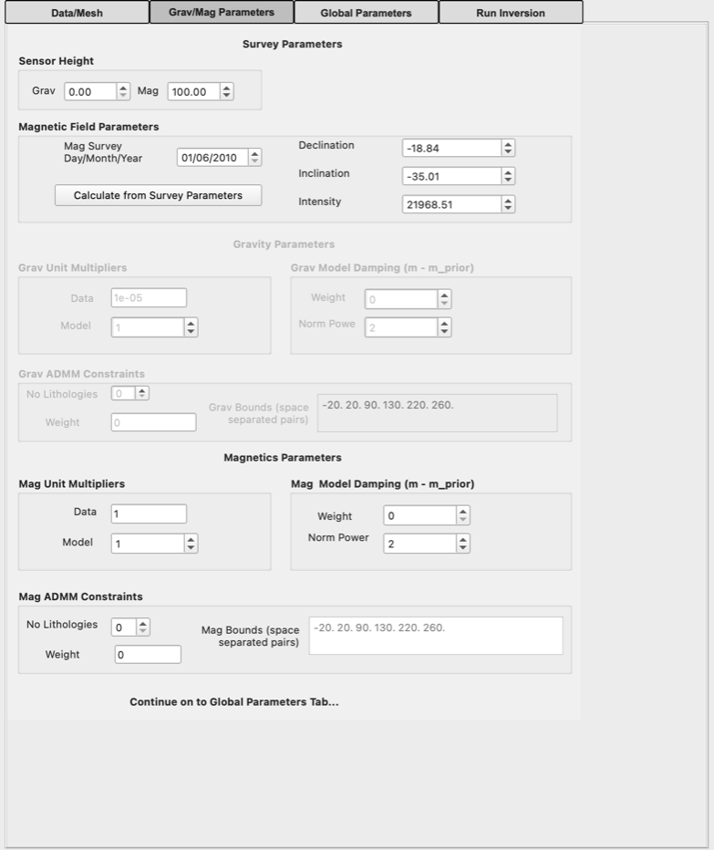

*After **Calculate from Survey Parameters** for the Cajati example.*

### Survey parameters

| Control | Applies | Parfile key | Default | Description |
|---|---|---|---|---|
| Sensor Height: Grav | 🟧 Grav | `#global.grav.sensor_height` | 0 | Height of the gravity sensor above the ground (draped survey). |
| Sensor Height: Mag | 🟦 Mag | `#global.magn.sensor_height` | 0 | Height of the magnetic sensor above the ground. Also used in the IGRF calculation. |
| Mag Survey Day/Month/Year | 🟦 Mag |  | 01/01/2000 | Date of the survey, for the IGRF calculation. |
| **Calculate from Survey Parameters** | 🟦 Mag |  |  | Fills in declination, inclination and intensity. For a Noddy GeoTIFF (for example imported with SGTool) the field stored in the file's metadata is used. Otherwise the IGRF-14 model is evaluated at the centre of the mesh (converted to WGS84), the sensor height and the survey date. |
| Declination | 🟦 Mag | `forward.magneticField.declination` | 0 | Degrees east of north. |
| Inclination | 🟦 Mag | `forward.magneticField.inclination` | −45 | Degrees, positive downwards. |
| Intensity | 🟦 Mag | `forward.magneticField.intensity_nT` | 65000 | Total field strength in nT. |

For a magnetic or joint inversion, **Save Files** refuses to continue (*Please define Magnetic Field Parameters*) while the field is still exactly 0 / −45 / 65000.

### Gravity parameters and magnetics parameters ⬜ Optional

| Control | Parfile key (grav / mag) | Default (grav / mag) | Description |
|---|---|---|---|
| Unit Multipliers: Data | `global.grav.dataUnitsMultiplier` / `global.magn.dataUnitsMultiplier` | 1e-5 / 1 | Multiplies the input data to convert them to SI units. 1e-5 converts mGal to m/s². Magnetic data in nT need 1. |
| Unit Multipliers: Model | `global.grav.modelUnitsMultiplier` / `global.magn.modelUnitsMultiplier` | 1 / 1 | Multiplies the model values when they are written out (for example to report density in other units). |
| Model Damping: Weight | `inversion.modelDamping.grav.weight` / `inversion.modelDamping.magn.weight` | 0 / 0 | Weight of the term that keeps the model close to the prior model (m − m_prior). |
| Model Damping: Norm Power | `inversion.modelDamping.normPower` | 2 / 2 | Exponent of the damping norm. There is only one key, so the magnetic value is written for magnetic inversions and the gravity value otherwise. |
| ADMM Constraints: No Lithologies | `inversion.admm.nLithologies` | 0 | Number of bound pairs. Above 0, ADMM bound constraints are switched on. See [section 15](#15-admm-bound-constraints). |
| ADMM Constraints: Weight | `inversion.admm.grav.weight` / `inversion.admm.magn.weight` | 0 | Weight of the bound constraint. Set to 1000 when you set No Lithologies above 0. |
| ADMM Constraints: Bounds | `inversion.admm.grav.bounds` / `inversion.admm.magn.bounds` | empty | Space-separated lower/upper pairs, one pair per lithology. |

Depth weighting is not shown in the panel. It is written as `forward.depthWeighting.type` (1 without a DTM, 2 with one), `forward.depthWeighting.grav.power = 2` (3 for gradiometry) and `forward.depthWeighting.magn.power = 3`.

---

## 8. Global Parameters tab

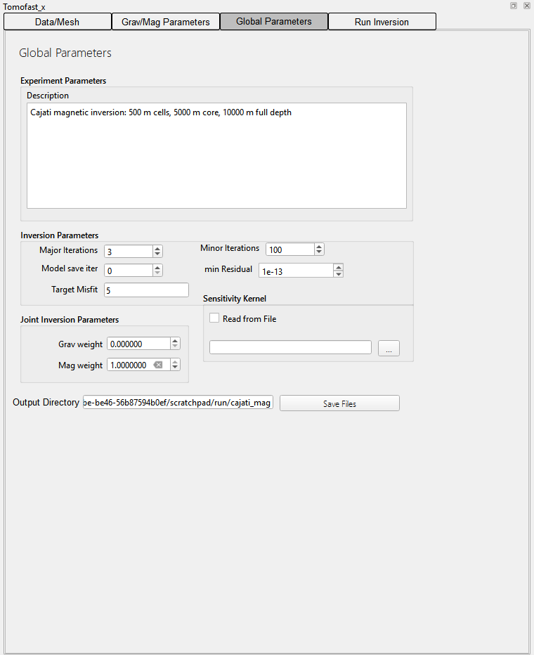

*Global Parameters for the Cajati example after **Save Files**.*

| Control | Applies | Parfile key | Default | Description |
|---|---|---|---|---|
| Description | ⬜ Optional | `global.description` | Inversion Experiment | Free text describing the experiment. |
| Major Iterations | ⬜ Optional | `inversion.nMajorIterations` | 3 | Outer iterations. Set to 50 automatically when ADMM is switched on, and back to 3 when it is switched off for both datasets. Joint inversions always write 15. |
| Minor Iterations | ⬜ Optional | `inversion.nMinorIterations` | 100 | LSQR iterations within each major iteration. |
| Model save iter | ⬜ Optional | `inversion.writeModelEveryNiter` | 0 | Write the model every N major iterations (0 = final model only). |
| min Residual | ⬜ Optional | `#inversion.minResidual` | 1e-13 | Stored for reference only (written as a comment). |
| Target Misfit | 🟩 Both (check) | `inversion.targetMisfit` | 1e-7 grav, 5 mag, 3 gradiometry | The inversion stops once the data misfit falls below this value. Leave the box empty to omit the key. |
| Grav weight / Mag weight | ⬜ Optional (joint) | `inversion.joint.grav.problemWeight` / `inversion.joint.magn.problemWeight` | 1 / 2.5e-6 | Relative weights of the two datasets in a joint inversion. For single inversions Save Files sets them to 1/0 or 0/1. |
| Sensitivity Kernel: Read from File | ⬜ Optional | `sensit.readFromFiles` | off (0) | Reuse a sensitivity matrix calculated earlier for the same mesh and data, which saves the forward calculation. Choose its folder with **...** (`sensit.folderPath`). Otherwise the kernel is written to `OUTPUT/SENSIT/`. |
| **Save Files** / Output Directory | 🟩 Both | `global.outputFolderPath` (`OUTPUT`) |  | Choose or create the folder for the input files. The plugin then writes the mesh, data, elevation grid and `paramfile.txt`, loads the data points and mesh into QGIS, and fills in **Path to parfile** on the Run tab. |

---

## 9. Run Inversion tab

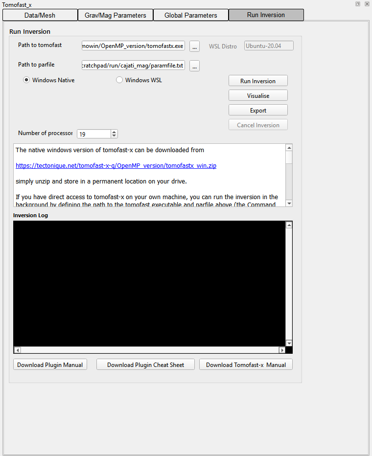

*Ready to run (Windows Native).*

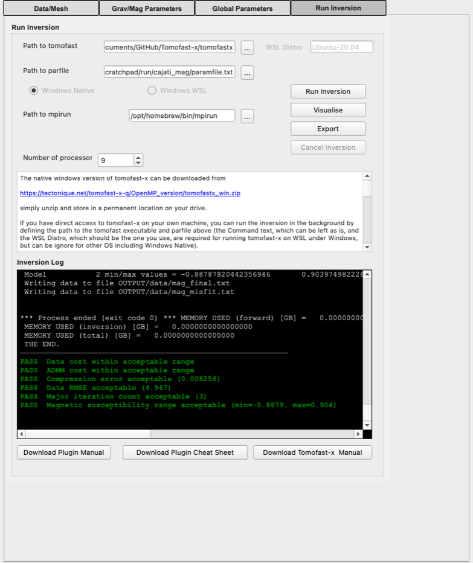

*Finished run with the post-run checks.*

| Control | Applies | Description |
|---|---|---|
| Path to tomofast | 🟩 Both | The Tomofast-x executable (`tomofastx.exe` on Windows, `tomofastx` elsewhere). Remembered in `tomoconfig.txt` in the plugin folder, together with the WSL distribution, mpirun path, run mode and number of processors. |
| Path to parfile | 🟩 Both | Filled in by Save Files. **...** chooses another parameter file. |
| Windows Native / Windows WSL | 🟩 Both (Windows) | Native runs `tomofastx.exe` directly. WSL runs Tomofast-x with `mpirun` in a WSL distribution, using a copy of the parfile (`paramfile.txt_run`) whose Windows paths are converted to Linux paths. Disabled on other systems. |
| WSL Distro | 🟩 Both (WSL) | Name of the distribution, e.g. `Ubuntu-20.04`: the name after `\\wsl.localhost\` in Windows paths to the WSL disk. |
| Path to mpirun | 🟩 Both (macOS/Linux) | Only shown on macOS and Linux. Needed if `mpirun` is not on the PATH, e.g. `/opt/homebrew/bin/mpirun`. |
| Number of processors | 🟩 Both | OpenMP threads (Windows Native) or MPI processes. Use one fewer than the number of cores. |
| **Run Inversion** |  | Starts Tomofast-x in the background with the parfile's folder as working directory. The output is written to `paramfile.txt_debug.txt` and shown live in the **Inversion Log**. On Windows Native the plugin also copies the parfile into the output folder. |
| **Cancel Inversion** |  | Stops the running job (on all platforms). |
| **Visualise** |  | Opens a 3D window with x, y and z half-model slices from `OUTPUT/Paraview/*_final_model3D_half_[xyz].vtk`. Padding cells are removed, all slices share one colour range (minimum to 95th percentile, `jet` colour map) and MVI models are coloured by magnitude. Joint inversions open one window per model. Needs `pyvista`. |
| **Export** |  | Writes `OUTPUT/grav_final_model3D_full.csv` and/or `mag_final_model3D_full.csv`: cell centres `x,y,z` (z positive upwards) and the value (`data`, or `Mx,My,Mz` for MVI). |
| Download Plugin Manual / Cheat Sheet / Tomofast-x Manual |  | Open the documents in your browser. |

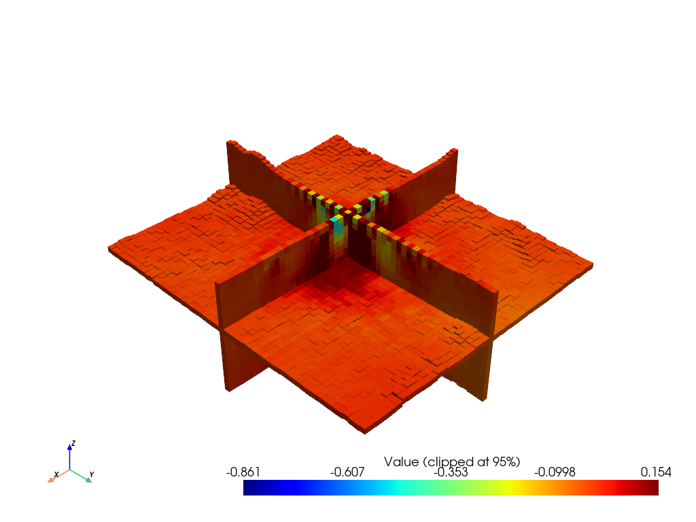

*The Cajati model as drawn by Visualise: half-model slices, padding removed, shared colour scale clipped at the 95th percentile.*

---

## 10. Post-run checks

When Tomofast-x finishes, the plugin reads `OUTPUT/costs.txt` and the run log and adds **PASS** (green) or **WARNING** (red) lines to the log. If the process ended with an error, the exit code is reported.

| Check | Warning when | Suggested action |
|---|---|---|
| Data cost | final grav or mag data cost (costs.txt columns 2, 3) > 0.1 | Relax constraints, e.g. reduce the ADMM weight. |
| ADMM cost | final ADMM cost (columns 6, 7) > 0.05 | Increase the ADMM weight or adjust the bounds. |
| Compression error | `COMPRESSION ERROR` in the log > 0.01 | Increase the compression rate (less compression). |
| Data RMSE (over-fitting) | last data RMSE < 4e-7 (gravity) or < 1 (magnetics). Skipped for gradiometry. | Raise `inversion.targetMisfit` to about this value. |
| Iteration count | more than 3 major iterations without ADMM | Use 3 major iterations for unconstrained inversions. |
| Density range | \|min\| or \|max\| of model 1 > 1000 | Check the gravity unit multipliers. |
| Susceptibility range | \|min\| or \|max\| of model 2 > 1 (scalar magnetic models only) | Check the magnetic units, and that the data are anomalies (see [section 6](#6-how-the-data-are-prepared)). |

The Cajati example passes every check except the susceptibility range (min −9.9, max 15.6), because the input grid is total field rather than an anomaly.

---

## 11. Files written and read

### Output directory (written by Save Files)

| File | Format |
|---|---|
| `paramfile.txt` | Tomofast-x parameter file ([section 12](#12-parameter-file-reference)). Paths are relative to this folder. |
| `model_grid.txt` | First line: number of cells. Then one line per cell: `x1 x2 y1 y2 z1 z2 i j k` (z positive down, relative to the topography when a DTM is used). |
| `data_grav.csv`, `data_magn.csv` | First line: number of points. Then `x y z value [value2 …]`, space-separated, with z = −(elevation + sensor height). |
| `elevation_grid.csv` | `x,y,elevation` for each mesh column (DTM only). |
| `reproj_data_*.tif`, `reproj_data_*.csv`, `data_temp.csv` | Intermediate files from the raster sampling. |
| `paraview_transform.py` | 2D profile mode only: a ParaView Programmable Filter script that moves the profile model back to real-world coordinates. |

### OUTPUT folder (written by Tomofast-x)

| Path | Contents |
|---|---|
| `model/grav_final_model_full.txt`, `model/mag_final_model_full.txt` | Final model value(s) for each cell, in the same order as `model_grid.txt`. |
| `data/*_observed.txt`, `*_final.txt`, `*_misfit.txt`, `*_starting.txt`, `*_prior.txt` | Observed data, the data predicted by the final model, the misfit, and the response of the starting and prior models. |
| `Paraview/*.vtk` | The full model, x/y/z half-models and the data, for ParaView or Visualise. |
| `SENSIT/` | The sensitivity kernel, which can be reused with *Read from File*. |
| `costs.txt` | Cost terms for each major iteration (data, model, ADMM, damping gradient, cross-gradient and clustering costs, for gravity and magnetics). |
| `*_final_model3D_full.csv` | Written by Export. |

The run log is `paramfile.txt_debug.txt` next to the parameter file.

---

## 12. Parameter file reference

The parameter file written for the Cajati magnetic example. Lines starting with `#` are read only by the plugin (Step 0). Tomofast-x ignores them.

```
===================================================================================
GLOBAL
===================================================================================
global.outputFolderPath             = OUTPUT
global.description                  = Cajati magnetic inversion: 500 m cells, 5000 m core, 10000 m full depth
#global.experimentType               = 2
#global.is_2d                        = 0
global.magn.dataUnitsMultiplier     = 1.0
global.magn.modelUnitsMultiplier    = 1.0
=== ELEVATION parameters ===
#global.elevType                     = 2
#global.magn.sensor_height                 = 100.0
=== MODEL GRID parameters ===
modelGrid.size                      = 71 77 16
modelGrid.magn.file                 = model_grid.txt
=== MAGNETIC FIELD constants ===
forward.magneticField.inclination                 = -35.01
forward.magneticField.declination                 = -18.84
forward.magneticField.intensity_nT                = 21968.51
=== DATA parameters ===
forward.data.magn.nData             = 2949
forward.data.magn.dataGridFile      = data_magn.csv
=== DEPTH WEIGHTING ===
forward.depthWeighting.type         = 2
forward.depthWeighting.magn.power   = 3
=== SENSITIVITY KERNEL ===
sensit.readFromFiles                = 0
sensit.folderPath                   = OUTPUT/SENSIT/
=== MATRIX COMPRESSION ===
forward.matrixCompression.type      = 1
forward.matrixCompression.rate      = 0.07096
=== INVERSION parameters ===
inversion.nMajorIterations          = 3
inversion.nMinorIterations          = 100
inversion.writeModelEveryNiter      = 0
#inversion.minResidual               = 1e-13
inversion.targetMisfit               = 5
=== MODEL DAMPING (m - m_prior) ===
inversion.modelDamping.magn.weight  = 0.0
inversion.modelDamping.normPower    = 2.0
=== JOINT INVERSION parameters ===
inversion.joint.grav.problemWeight  = 0.0
inversion.joint.magn.problemWeight  = 1.0
=== ADMM constraints ===
inversion.admm.enableADMM           = 0
inversion.admm.nLithologies         = 0
inversion.admm.grav.weight          = 0
inversion.admm.magn.bounds          = -1d-10 1d10
inversion.admm.magn.weight          = 0
=== MESH ===
#mesh.cellx                          = 500
#mesh.celly                          = 500
#mesh.cellz                          = 500.0
#mesh.padding                        = 10000
#mesh.z.coreDepth                       = 5000.0
#mesh.z.fullDepth                  = 10000.0
#mesh.south                          = 7250895
#mesh.west                           = 777617
#mesh.north                          = 7279422
#mesh.east                           = 803477
=== ANOMALIES ===
#global.elevFilename                 = …/10_TOPOGRAPHY/ALPSMLC30_S025W049_DSM_clipped_reproj.tif
#roi.filename                        = …/7_GEOPHYSICS/RegionOfInterest.shp
#anomalies.magn.data.file            = …/7_GEOPHYSICS/Parana_Santa_Catarina_1095_MAGMIC_clipped.tif
#anomalies.magn.proj.in              = EPSG:31982
#anomalies.magn.proj.out             = EPSG:31982
```

(Section banners are shortened and the absolute paths are abbreviated here.)

### Keys written only in some cases

| Key | Written when |
|---|---|
| `modelGrid.grav.file`, `forward.data.grav.*`, `global.grav.*`, `forward.depthWeighting.grav.power` | Gravity or joint inversion. |
| `modelGrid.magn.file`, `forward.data.magn.*`, `global.magn.*`, `forward.magneticField.*`, `forward.depthWeighting.magn.power` | Magnetic or joint inversion. |
| `forward.data.grav.type`, `forward.data.grav.nDataComponents`, `forward.data.magn.nDataComponents`, `modelGrid.magn.nModelComponents` | Only when not 1 (gradiometry, multi-component data, MVI). |
| `forward.magneticField.XaxisDeclination` | 2D profile mode with magnetics: rotation of the profile. |
| `inversion.crossGradient.weight = 80`, `inversion.crossGradient.derivativeType = 1` | Joint inversion. |
| `inversion.admm.dataCostThreshold = 0.1e-3`, `inversion.admm.weightMultiplier = 2.0`, `inversion.admm.maxWeight = 1e10` | ADMM on (No Lithologies > 0). |
| `inversion.admm.*.bounds = -1d-10 1d10` | ADMM bounds left empty (no effective bound). |
| `sensit.folderPath = <chosen folder>` | Read from File ticked. |

Step 0 also recognises `global.elevFilename`, `roi.filename`, `anomalies.*`, `mesh.*` and the sensor heights with or without the leading `#`, and Fortran-style numbers such as `1d-5`.

---

## 13. Magnetisation vector inversion (MVI) and gravity gradiometry

| Drop-down | Choices | Parfile key |
|---|---|---|
| Gravity: type | Gravity / Gradiometry | `forward.data.grav.type = 1 / 2` |
| Gravity: components | 1 (Gz or Gzz) / 6 (xx, yy, zz, xy, yz, xz). Fixed at 1 for gravity. | `forward.data.grav.nDataComponents` |
| Magnetic: data | TMI (1) / Bx,By,Bz (3) | `forward.data.magn.nDataComponents` |
| Magnetic: model | Scalar / Vector (MVI: Mx, My, Mz per cell) | `modelGrid.magn.nModelComponents = 1 / 3` |

- **Gradiometry** data are in Eötvös. The depth-weighting power becomes 3 and the default target misfit 3. The RMSE over-fitting check is skipped.
- **MVI** roughly triples the sensitivity matrix and the run time. Visualise colours the model by the magnitude of the vector, Export writes `Mx,My,Mz`, and the susceptibility range check is not applied.
- The memory estimate is multiplied by (data components × model components).
- **CSV files**: the selected Data column is the first component, and the following columns hold the others in the order above.
- **GeoTIFFs**: select any one component file. The others must be in the same folder, on the same grid, and have the same name apart from a component tag (`xx` … `xz`, or `Bx`/`By`/`Bz`, any case) set off by `_`, `-` or `.`, e.g. `gg_xx.tif` … `gg_xz.tif` or `mag_Bx.tif`, `mag_By.tif`, `mag_Bz.tif`. A missing file or a different grid gives an error when the data are loaded.

---

## 14. Joint inversion

- Load both datasets (Steps 2a and 3a), each with its own Load button. With CSV files, each load only fills that dataset's column lists.
- The mesh, DTM and ROI use the **gravity** output CRS, so use the same CRS for both datasets.
- Both models share one mesh. The datasets are coupled by a cross-gradient constraint (weight 80) and weighted by *Grav weight* and *Mag weight* (defaults 1 and 2.5e-6) on the Global Parameters tab.
- The parameter file always uses 15 major iterations for a joint inversion, whatever the panel shows.
- Visualise and Export handle both models.

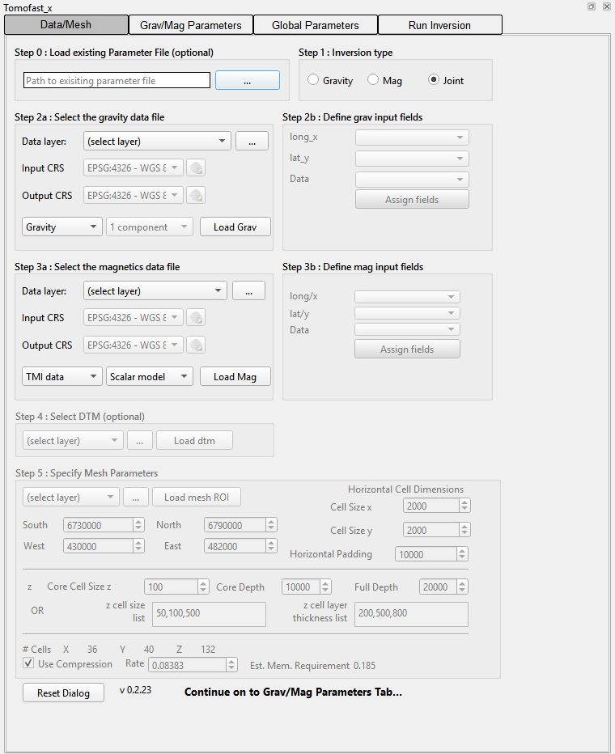

*Joint selected: the gravity and magnetic data groups are both enabled.*

---

## 15. ADMM bound constraints

ADMM keeps each cell's value within one of several allowed ranges (one per lithology).

- **No Lithologies**: the number of ranges. Typing a value above 0 switches ADMM on, sets the ADMM weight to 1000 and the major iterations to 50. Setting it back to 0 resets the weight to 0, and the major iterations to 3 if ADMM is off for both datasets.
- **Bounds**: space-separated pairs `lower upper`, e.g. `-20. 20. 90. 130. 220. 260.` for three ranges.
- **Density bounds are density contrasts**: subtract the reference density (2670 kg/m³) from rock densities before entering them, as the cheat sheet notes.
- **Magnetic bounds** are susceptibilities in SI.
- The post-run checks warn if the ADMM cost stays above 0.05 or the data cost rises above 0.1.

---

## 16. 2D profile inversion

Choose a **line** layer with exactly two vertices as the mesh ROI. The plugin then:

- disables South/North/West/East and builds a mesh along the profile, one core cell wide across it, with padding on all sides;
- samples raster data along the line and writes the data and mesh in profile coordinates (x along the profile, y = 0), so that the mesh edges are parallel to the axes;
- multiplies the automatic compression rate by 100 (2D problems are small);
- for magnetics, writes `forward.magneticField.XaxisDeclination` so that the field is rotated into the profile direction;
- writes `paraview_transform.py` to move the result back to map coordinates in ParaView. Visualise shows the y half-model.

---

## 17. Troubleshooting

| Problem | Cause and fix |
|---|---|
| Target Misfit still shows `1e-07` after choosing Mag | In version 0.2.23 the starting value is shown as `1e-07`, which the plugin does not recognise as the gravity default, so it is not swapped. Type `5` for magnetic inversions. |
| Layer not in a drop-down | Only layers saved to disk in a suitable format are listed. Save memory or temporary layers first, or use **...**. |
| *Please define Magnetic Field Parameters* | Press **Calculate from Survey Parameters** or enter the field by hand. |
| *Data CRS changed … reload the mesh ROI / DTM* | New data with a different CRS were loaded after the ROI or DTM. Load them again. |
| *Paths to tomofastx and paramfile must be defined* | Set Path to tomofast, and Save Files (or choose a parfile). |
| Exit code 3221225725 (0xC00000FD) on Windows | Tomofast-x ran out of stack space (large problems such as MVI). Run `python scripts/set_exe_stack.py path\to\tomofastx.exe`, or link the executable with `-Wl,--stack,536870912`. The plugin already sets `OMP_STACKSIZE=512M`. |
| Memory estimate too large | Use larger cells, a smaller core area, less depth or less padding, or a smaller compression rate. |
| Susceptibility or density range warning | Check the unit multipliers, and that the data are anomalies rather than total field or absolute gravity. |
| Visualise does nothing | Install `pyvista` in the QGIS Python environment. Messages appear in the QGIS Python console. |
| Running on another computer | Copy the whole output folder. The paths in `paramfile.txt` are relative, then run `tomofastx -p paramfile.txt` (or `mpirun -np N tomofastx -p paramfile.txt`) in that folder. |

---

## 18. ArcGIS Pro toolbox

The repository also contains a beta ArcGIS Pro toolbox (`ARCGIS/Tomofast_X.pyt`) whose panel mirrors the QGIS plugin. Add it with **Toolboxes > Add Toolbox**. Run **Setup > Set Up Python Environment** once: it clones `arcgispro-py3` into `arcgispro-py3-geotools`, installs the required packages (including shapely 2 and pyvista) and activates the clone. Restart ArcGIS Pro, then run **Open Tomofast-x Panel**. See the [README](https://github.com/TOMOFAST/tomofast-x-q#arcgis-pro-this-is-very-beta) for details.

---

Tomofast-x-q plugin by Mark Jessell and Vitaliy Ogarko. Tomofast-x by Vitaliy Ogarko. IGRF calculation uses [ppigrf](https://github.com/klaundal/ppigrf).
