# Tomofast-x-q User Manual

QGIS plugin for setting up, running and viewing Tomofast-x gravity and magnetic inversions. Plugin version 0.2.23.

[Reference Manual](ReferenceManual.md) · [Changelog](../CHANGELOG.md) · [Cheat sheet (PDF)](https://tectonique.net/tomofast-x-q/Tomofast-x-q%20cheat%20sheet.pdf) · [README](../README.md)

> [!NOTE]
> **This manual only covers the fields you must fill in** to get from your data to an inversion result. Every other field has a sensible default and is left alone here. The [Reference Manual](ReferenceManual.md) describes every field on every tab, the files the plugin writes and the parameter-file names.

**Colour key** (the same as the cheat sheet):

| Tag | Meaning |
|---|---|
| 🟧 **Grav** | gravity inversions |
| 🟦 **Mag** | magnetic inversions |
| 🟩 **Both** | every inversion (gravity, magnetic or joint) |
| ⬜ **Optional** | not needed, but used in this example |

For a **joint** inversion, fill in everything marked 🟧 Grav, 🟦 Mag and 🟩 Both.

**Contents**

0. [Example data](#example-data)
1. [Before you start](#1-before-you-start)
2. [How the plugin is organised](#2-how-the-plugin-is-organised)
3. [Data/Mesh tab](#3-datamesh-tab)
4. [Grav/Mag Parameters tab](#4-gravmag-parameters-tab)
5. [Global Parameters tab: save the input files](#5-global-parameters-tab-save-the-input-files)
6. [Run Inversion tab: run, view and export](#6-run-inversion-tab-run-view-and-export)
7. [Differences for gravity and joint inversions](#7-differences-for-gravity-and-joint-inversions)
8. [Where next](#8-where-next)

---

## Example data

To follow the manual with the same data, download **[Cajati.zip](https://tectonique.net/tomofast-x-q/Cajati.zip)** (about 25 MB). Unzip it and open `Cajati/Cajati_Package_clip.qgz` in QGIS. The airborne magnetic grid and the area around the Cajati alkaline complex, Brazil, are courtesy of the [Brazilian Geological Survey (SGB)](https://www.sgb.gov.br/home).

The zip contains:

| File | Contents |
|---|---|
| `Parana_Santa_Catarina_1095_MAGMIC_clipped_RR.tif` | **The magnetic grid used in this manual**: the SGB total magnetic intensity grid with its regional trend removed (125 m cells, SIRGAS 2000 / UTM 22S). |
| `Parana_Santa_Catarina_1095_MAGMIC_clipped.tif` | The original total-field grid, for comparison (hidden in the project). |
| `ALPSMLC30_S025W049_DSM_clipped_reproj.tif` | ALOS 30 m digital surface model, used as the DTM. |
| `RegionOfInterest.shp` | The rectangle used as the core of the mesh. |
| `world_borders.shp` | Country outlines for context. |

**Why the regional is removed.** The original grid holds total-field values that average about 22,855 nT. Tomofast-x fits data as they are, so it needs unrealistic susceptibilities to fit such large values. The `_RR` grid was made with the **Remove Regional** filter (1st order) of the [SGTool](https://github.com/swaxi/SGTool) QGIS plugin. It fits a plane to the grid by least squares and subtracts it, so the result is centred on zero: the mean is 0 nT and the values run from −3,312 to 2,163 nT. To prepare your own data in the same way, open the grid in SGTool and tick **Remove Regional** with a 1st-order fit. Use 2nd order if a plane does not remove the trend.

---

## 1. Before you start

### Install the plugin

In QGIS open **Plugins > Manage and Install Plugins**, search for **tomofast_x_q** and install it. To get the newest version instead, download the zip file of the **main** branch from [github.com/TOMOFAST/tomofast-x-q](https://github.com/TOMOFAST/tomofast-x-q) and use **Install from ZIP**. The plugin works in QGIS 3.24 to QGIS 4.x. Click the **TF-x** toolbar button to open the plugin panel. It docks on the right of the QGIS window.

### Install Tomofast-x

The plugin prepares the input files. The inversion itself is done by the separate Tomofast-x program, which you can run from the plugin if it is on the same computer.

- **Windows**: download [tomofastx_win.zip](https://tectonique.net/tomofast-x-q/OpenMP_version/tomofastx_win.zip), unzip it and keep `tomofastx.exe` somewhere permanent. No MPI installation is needed.
- **macOS and Linux** (and Windows through WSL): build Tomofast-x as described in the [installation instructions](https://github.com/TOMOFAST/Tomofast-manual/blob/main/install.md).

**Visualise** (a 3D view of the result) also needs the `pyvista` Python package in the Python that QGIS uses.

### Prepare your data

- **Gravity or magnetic data**: a GeoTIFF or ERS grid, or a CSV file of points with x, y and data columns. A layer you pick from the QGIS project must be saved to disk.
- **Use anomalies, not total field.** Tomofast-x fits the data as they are. Remove the main (IGRF) field and any regional trend from magnetic data, for example with SGTool's **Remove Regional** (see [Example data](#example-data)), and use a Bouguer anomaly for gravity.
- Use a projected coordinate system in metres. Grids are used in their own CRS. CSV points can be reprojected by the plugin.

### The example in this manual

The screenshots show a magnetic inversion of the [example data](#example-data) (`Cajati_Package_clip.qgz`), taken on macOS. On Windows and Linux the panel looks slightly different.

| Input | File |
|---|---|
| Magnetic grid | `Parana_Santa_Catarina_1095_MAGMIC_clipped_RR.tif` (regional removed, 125 m cells, SIRGAS 2000 / UTM 22S) |
| DTM | `ALPSMLC30_S025W049_DSM_clipped_reproj.tif` |
| Region of interest | `RegionOfInterest.shp` |
| Mesh | 500 m cells in x, y and z, a 5,000 m deep core and a full depth of 10,000 m |

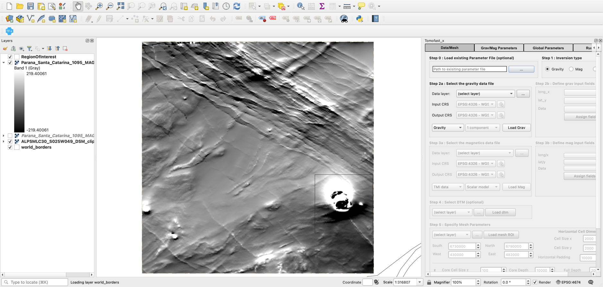

*Figure 1. The Cajati project in QGIS with the regional-removed magnetic grid displayed (grey scale ±219 nT). The plugin panel is docked on the right, showing its starting state (Gravity selected and default mesh values).*

---

## 2. How the plugin is organised

The panel has four tabs. Work through them from left to right:

1. **Data/Mesh**: choose the inversion type, load the data and define the 3D model mesh.
2. **Grav/Mag Parameters**: give the sensor height and, for magnetics, the Earth's field.
3. **Global Parameters**: choose an output folder. **Save Files** writes the data, mesh and parameter file.
4. **Run Inversion**: run Tomofast-x, check the result, view it and export it.

Hold the mouse over any field to see a tooltip. The name in square brackets, for example `[forward.magneticField.inclination]`, is the matching parameter-file entry.

---

## 3. Data/Mesh tab

### Step 1: Inversion type 🟩 Both

Choose **Gravity**, **Mag** or **Joint**. Only the boxes for that type are enabled: in the example, choosing **Mag** greys out the gravity boxes.

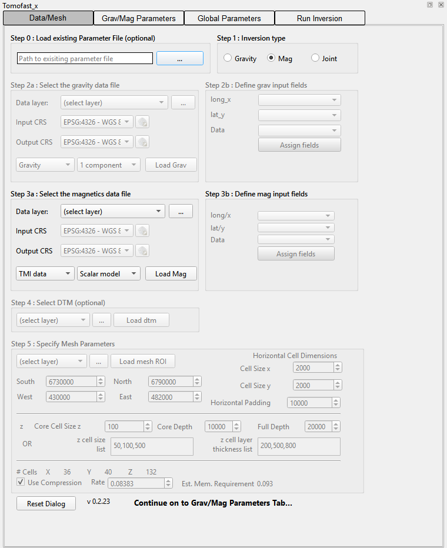

*Figure 2. Mag selected. The gravity boxes (Step 2a/2b) are disabled and the magnetics boxes (Step 3a/3b) are enabled.*

### Step 3a: Select the magnetics data file 🟦 Mag

(For gravity, use Step 2a in the same way.)

- **Data layer**: pick the grid or CSV layer from the drop-down list, which shows the layers in your project that are saved to disk. Alternatively, press **...** to choose a file on disk.
- **Load Mag**: reads the data. For a grid, the layer extent is copied into the South/North/West/East mesh limits in Step 5. Press **Load Mag** again whenever you change the file.

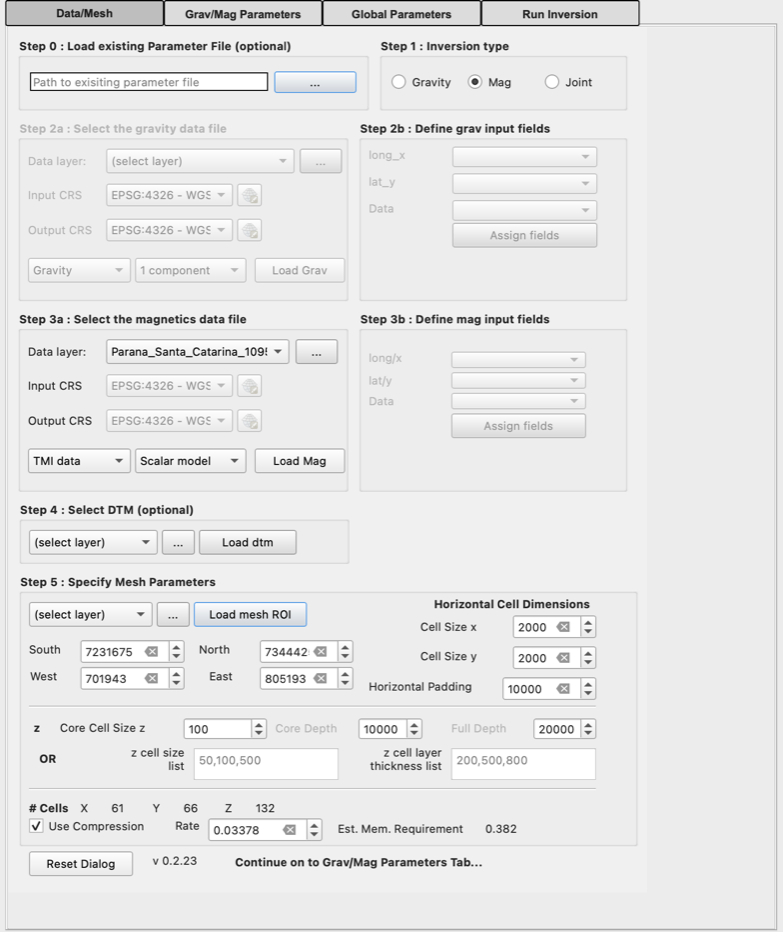

*Figure 3. The regional-removed magnetic grid (`…_clipped_RR`) chosen and loaded. Step 5 now holds the extent of the grid.*

### Steps 2b/3b: CSV point data only 🟧 Grav 🟦 Mag

Skip this for grids. For a CSV file:

- **Input CRS** and **Output CRS** (Step 2a/3a): the CRS of the coordinates in the file, and the projected CRS (in metres) to work in. Set both *before* pressing **Load**.
- **long/x**, **lat/y**, **Data**: choose the coordinate and data columns, then press **Assign fields**. The points are added to the map.

### Step 4: Select DTM ⬜ Optional

Without a DTM the ground is taken as flat at elevation 0. The example uses one: pick the DTM layer and press **Load dtm**. A reprojected copy called *Reprojected DTM* is added to the map.

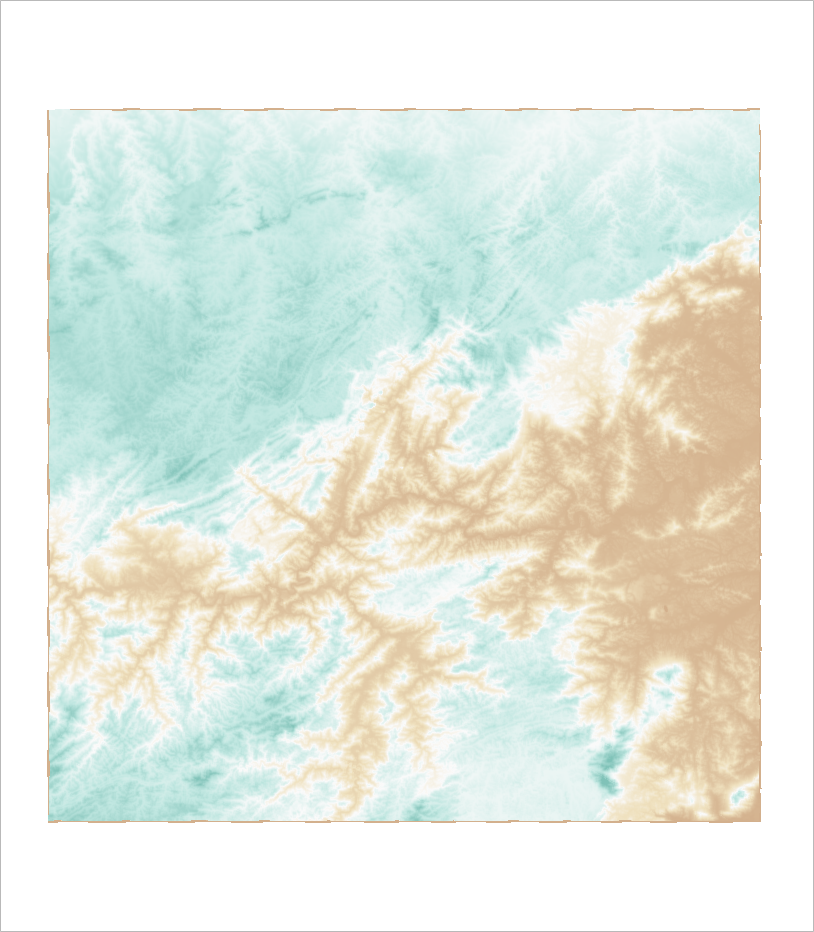

*Figure 4. The DTM used for the example (project symbology).*

### Step 5: Specify mesh parameters 🟩 Both

**Mesh limits.** **South**, **North**, **West** and **East** define the core of the model: the area you want to image. They start as the extent of the data, which is often too large. You can type new limits, or (⬜ Optional) pick a polygon layer and press **Load mesh ROI** to use the rectangle around it (the example does this).

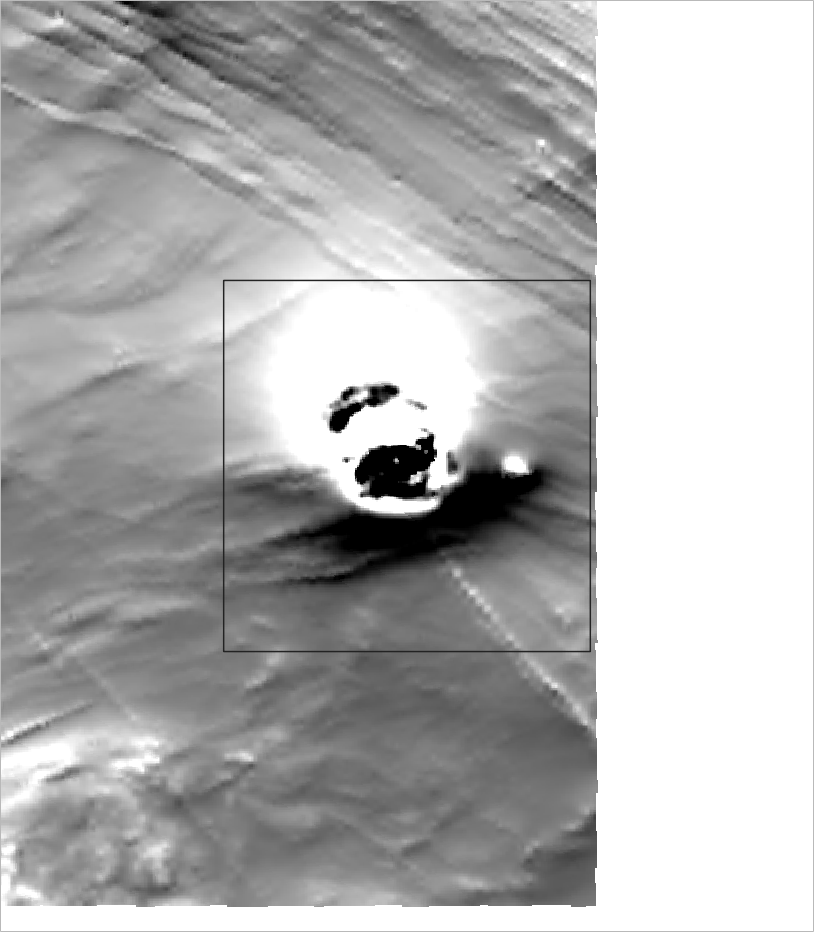

*Figure 5. The region of interest (outlined) over the magnetic grid. Its bounding rectangle becomes the core of the mesh.*

**Cell sizes and padding.**

- **Cell Size x**, **Cell Size y**: horizontal cell size in metres. Example: **500**.
- **Horizontal Padding**: extra distance added around the core, in cells that get larger outwards, so that edge effects stay outside the core. It is set automatically to the model depth (10,000 m here). You can change it afterwards.

**Depth.** Use *one* of these two methods:

- **Core Cell Size z**, **Core Depth**, **Full Depth**: cells of the core cell size down to the core depth, then cells that grow by 15% each down to the full depth. Example: **500**, **5000** and **10000**.
- **OR** the **z cell size list** and **z cell layer thickness list**: comma-separated lists giving a cell size for each depth layer, for example `50,100,500` and `200,500,800`. Each thickness should be a multiple of its cell size. When the lists are filled in they replace the core/full depth settings.

**Check the size.** **# Cells** and **Est. Mem. Requirement** (GB) update as you type. Make sure the memory estimate fits in your computer's memory. If it is too large, use larger cells or a smaller area. **Use Compression** is ticked and the **Rate** is set for you. Leave both as they are.

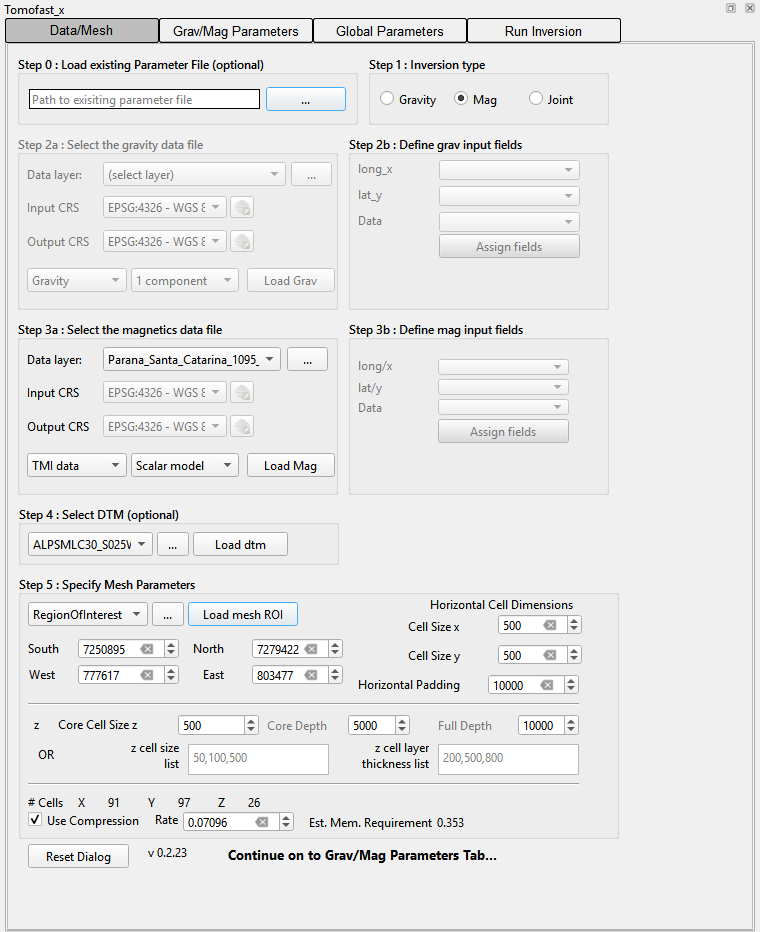

*Figure 6. The finished Data/Mesh tab for the example: 500 m cells, 5,000 m core and 10,000 m full depth. The estimated memory is 0.35 GB.*

> [!NOTE]
> The **# Cells** figures are a deliberate over-estimate. The mesh that is written uses fewer, larger padding cells (71 × 77 × 16 cells for the example), so the real memory use is lower than the estimate.

---

## 4. Grav/Mag Parameters tab

- 🟩 **Both** · **Sensor Height**, **Grav** / **Mag**: height of the sensor above the ground in metres, assuming a draped survey. Use 0 for ground surveys. The example uses **100** m for an airborne magnetic survey.
- 🟦 **Mag** · **Mag Survey Day/Month/Year** then **Calculate from Survey Parameters**: computes the Earth's field (declination, inclination and intensity) from the IGRF model at the centre of the mesh, on the survey date and at the sensor height. For a Noddy GeoTIFF the values stored in the file are used instead. You can also type the three values directly.

> [!WARNING]
> **Magnetic inversions need this step.** If the field is left at the defaults (declination 0, inclination −45, intensity 65,000), **Save Files** stops with the message *Please define Magnetic Field Parameters*.

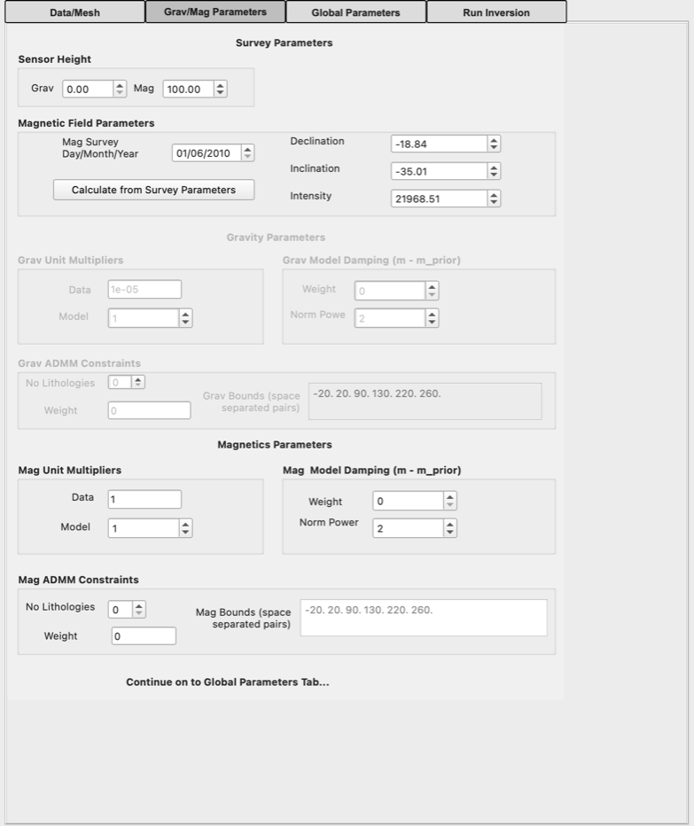

*Figure 7. Sensor height and Earth's field for the example (survey date 1 June 2010). Use the real date of your survey.*

Everything else on this tab (unit multipliers, model damping, ADMM constraints) is optional. See the [Reference Manual](ReferenceManual.md#7-gravmag-parameters-tab).

---

## 5. Global Parameters tab: save the input files

- 🟦 **Mag** · **Target Misfit**: check that it is **5** for a magnetic inversion. In version 0.2.23 it can stay at the gravity value (`1e-07`) after you switch to Mag, so type **5** if needed. For gravity leave it at `1e-07`.
- 🟩 **Both** · **Save Files**: choose (or create) an empty output folder. The plugin then writes the files Tomofast-x needs and loads the data points and mesh into QGIS.

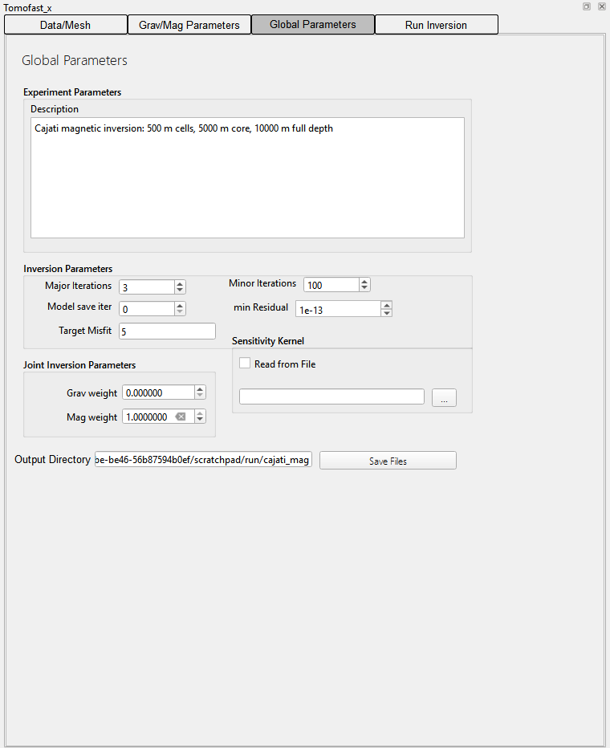

*Figure 8. Global Parameters after **Save Files**. The output folder is shown next to the button.*

The output folder now holds:

| File | Contents |
|---|---|
| `paramfile.txt` | The Tomofast-x parameter file. All paths in it are relative to this folder. |
| `data_magn.csv` / `data_grav.csv` | The data as x, y, z, value. Grids are sampled at the centre of each core cell. |
| `model_grid.txt` | The model mesh, including the padding cells. |
| `elevation_grid.csv` | Ground elevation for each mesh column (only when a DTM is used). |

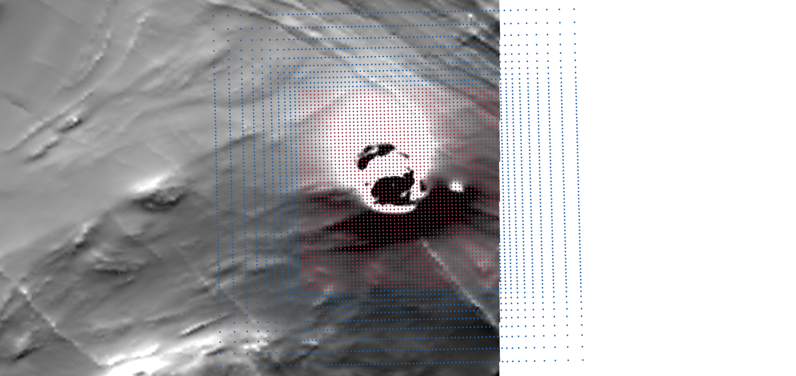

*Figure 9. After Save Files: mesh cell centres (blue) and data points (red, one per core cell). The padding cells grow outwards from the core. In the plugins the data will have a colour scale based on the data value, and hte mesh will be smaller black points*

---

## 6. Run Inversion tab: run, view and export

- 🟩 **Both** · **Path to tomofast**: press **...** and choose the Tomofast-x program (`tomofastx.exe` on Windows). It is remembered for next time.
- 🟩 **Both** · **Path to parfile**: filled in automatically with the `paramfile.txt` just saved.
- 🟩 **Both** · **Windows Native** or **Windows WSL** (Windows only): choose Windows Native for `tomofastx.exe`. With WSL, also type the name of your Linux distribution in **WSL Distro**. On macOS and Linux, give the path to **mpirun** if it is not on the PATH.
- 🟩 **Both** · **Number of processors**: use one fewer than the number of cores in your computer.
- **Run Inversion**: starts Tomofast-x in the background. Its output appears in the **Inversion Log**. **Cancel Inversion** stops it.

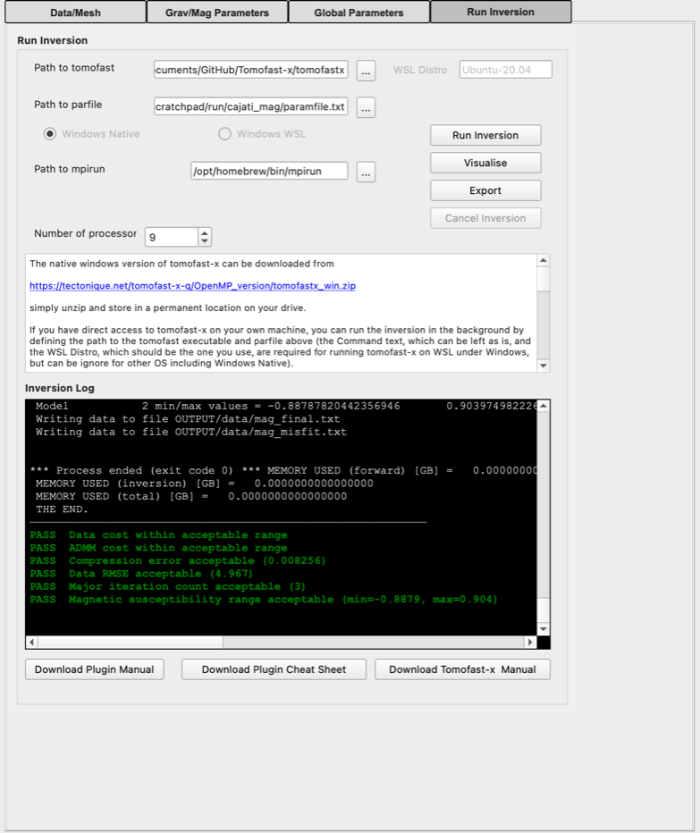

*Figure 10. The finished example run (under a minute with 9 processes on a recent Mac; about 1.5 minutes on a Windows PC). The log ends with `THE END`, followed by the plugin's automatic checks.*

### Check the result

When the run ends, the plugin checks the result and adds green **PASS** or red **WARNING** lines to the log. They cover the data fit, the compression error, possible over-fitting, the number of iterations and whether the model values are in a sensible range. Each warning suggests what to change. The [Reference Manual](ReferenceManual.md#10-post-run-checks) lists all the checks.

The example run passes every check. The final model's susceptibilities range from −0.89 to 0.90 SI.

> [!WARNING]
> If you invert the original total-field grid (`Parana_Santa_Catarina_1095_MAGMIC_clipped.tif`, about 22,855 nT on average) instead of the `_RR` grid, the run ends with *WARNING Check magnetic susceptibility unit scaling* (min −9.9, max 15.6). Tomofast-x needs unrealistic susceptibilities to fit total-field values. Remove the main field (IGRF) or a regional trend from your grid before the inversion, as described in [Example data](#example-data).

### View and export

- **Visualise**: opens a 3D view of the final model as x, y and z slices through the core of the mesh. The colours are clipped at the 95th percentile. Needs `pyvista`.
- **Export**: writes the final model as `mag_final_model3D_full.csv` (or `grav_…`) in the `OUTPUT` folder, with x, y, z and value columns. You can load it into QGIS or other software.

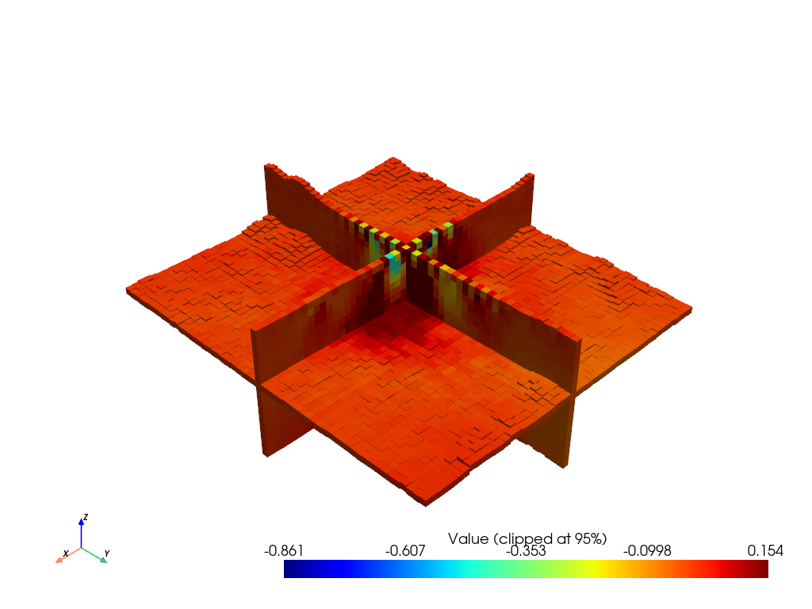

*Figure 11. The example model shown as Visualise draws it: half-model slices in x, y and z, padding removed, colours clipped at the 95th percentile (here −0.86 to 0.15 SI). The strongest susceptibilities lie under the Cajati anomaly at the centre of the core.*

The full results are in the `OUTPUT` folder: `Paraview/` holds VTK files you can open in ParaView, and `model/` and `data/` hold the final model and the observed, predicted and misfit data. Here we show a thresholded version of the susceptibility model with 400m cells using Paraview:     
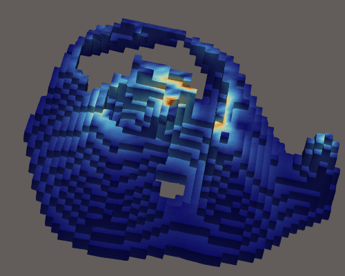  
*Figure 12. Magnetic inversion of the igneous intrusions hosting  the Cajati Carbonatite complex, SE Brazil.*

---

## 7. Differences for gravity and joint inversions

| | 🟧 Gravity | 🟦 Magnetic | 🟩 Joint |
|---|---|---|---|
| Step 1 | Gravity | Mag | Joint |
| Data | Step 2a (and 2b for CSV), **Load Grav** | Step 3a (and 3b for CSV), **Load Mag** | Both, each with its own Load button |
| Grav/Mag Parameters | Grav sensor height | Mag sensor height, survey date, **Calculate from Survey Parameters** | Both sensor heights, plus the magnetic field |
| Target Misfit | `1e-07` | `5` | Leave as set |

Gravity data are expected in mGal: the default **Data** unit multiplier of `1e-05` converts them to SI units. Change it on the Grav/Mag Parameters tab if your data use other units.

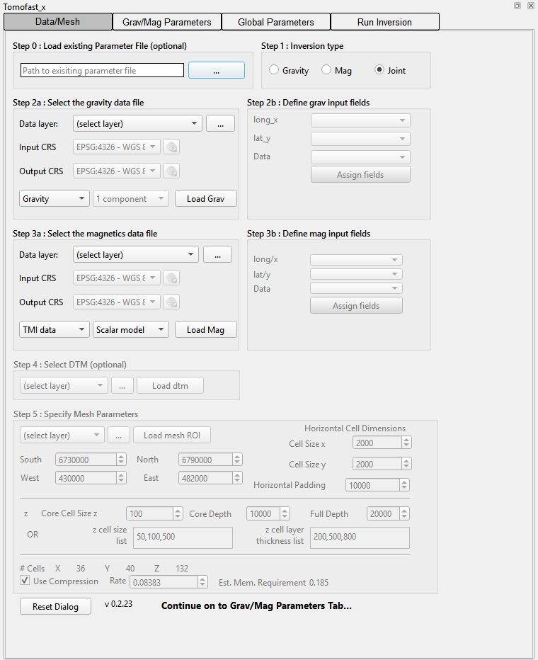

*Figure 13. With Joint selected, both the gravity and magnetic data boxes are enabled.*

---

## 8. Where next

- The [Reference Manual](ReferenceManual.md) describes every field, including the optional ones skipped here: loading an existing parameter file, unit multipliers, model damping, ADMM bound constraints, joint weights, magnetisation vector inversion (MVI), gravity gradiometry, 2D profile inversion and re-using a sensitivity kernel.
- The [Changelog](../CHANGELOG.md) lists what changed in each version.
- Report problems on the [issue tracker](https://github.com/TOMOFAST/tomofast-x-q/issues).

---

Tomofast-x-q plugin by Mark Jessell and Vitaliy Ogarko. Tomofast-x by Vitaliy Ogarko. IGRF calculation uses [ppigrf](https://github.com/klaundal/ppigrf).
